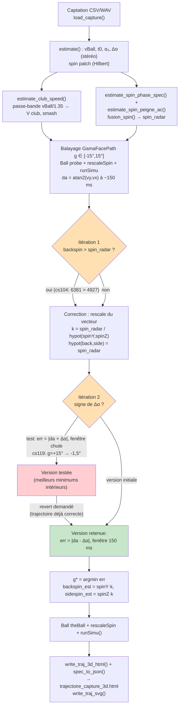

# Simulateur de vol de balle de golf — C++ (`Cpp/src/`)

Simulation complète : vol (traînée de White, Magnus/Smits & Smith, gravité) + 3 rebonds (Penner/Roh & Lee) + roulement, avec sorties texte, image 2D (SVG / PNG-CImg), **scène 3D interactive HTML** (three.js, rotation souris) et **analyse radar avancée** des captations (vitesse club, spin multi-voies, décomposition back/side spin).

## Compilation (Mac / Linux, g++ ou clang++)

```bash
cd Cpp/src

# version de base (console + SVG + HTML 3D, aucune dépendance)
g++ -O2 -std=c++11 -o simu_headless \
    Simu_headless.cpp Ball.cpp Club.cpp EquationODE.cpp EquationODEFlight.cpp \
    EquationODERoll.cpp EquationODEEventFlight.cpp EquationODEEventRoll.cpp SolverODE.cpp

# outil de visualisation multi-spectres d'une captation (HTML autonome, pur canvas 2D)
g++ -O2 -std=c++11 -I. -o spectres_html spectres_html.cpp

# PNG de densité spectrale (voir plus bas)
g++ -O2 -std=c++11 -I. -o spectro_png spectro_png.cpp

# version avec image PNG via CImg (headless : -Dcimg_display=0 ; PNG si libpng, sinon BMP)
g++ -O2 -std=c++11 -Dcimg_display=0 -DUSE_CIMG -I. -o simu_headless_cimg \
    Simu_headless.cpp Ball.cpp Club.cpp EquationODE.cpp EquationODEFlight.cpp \
    EquationODERoll.cpp EquationODEEventFlight.cpp EquationODEEventRoll.cpp SolverODE.cpp
```

L'ancien `Simu.cpp` (avec `CImg::display_graph` en fenêtre) se compile sur PC/avec XQuartz : remplacer `Simu_headless.cpp` par `Simu.cpp` et ajouter `-Dcimg_display=1` + les libs d'affichage.

## Commandes

```bash
./simu_headless --help        # aide complète : usage, options, sorties, exemples (en couleur)

# simulation "club" : Type ClubV0(km/h) AlphaClubPath(deg) GamaFacePath(deg) ShaftLean(deg) [spinScale]
./simu_headless F7 122.3 0 0 -6.5 --open     # fer 7 à 122,3 km/h, ouvre le HTML 3D
./simu_headless Dr 170.6 -8 2 6              # driver
./simu_headless F7 122.3 0 0 -6.5 0          # spin nul (test Magnus)

# depuis une captation radar (CSV 2 lignes ';' ou WAV stéréo 44,1 kHz) — analyse fusion par défaut
./simu_headless --capture ../../sci/2019-02-24-F7-123m-150kmh-5274trm-210trm-cs111.wav --open
./simu_headless --capture ../../sci/2025-11-08-F7-131m-162kmh-9418trm-7102trm-cs124.csv F7 1.0
./simu_headless --capture <fichier> --mode standard     # ancien : patch Hilbert seul

# spectres multi-panneaux d'une captation (8 panneaux, voir plus bas)
./spectres_html ../../sci/2019-02-24-F7-123m-150kmh-5274trm-210trm-cs111.csv -o
for f in ../../sci/*.csv; do ./spectres_html "$f"; done   # tous les spectres + index
```

Clubs disponibles : `Dr B5 H3 F5 F6 F7 F8 F9 PW AW SW LW Pt`. `-o` / `--open` ouvre le HTML généré automatiquement (`open` sur Mac).

## Options

| Argument | Défaut | Rôle |
|---|---|---|
| `Type` | — | club (voir liste) |
| `ClubV0` | config club | vitesse club en km/h |
| `AlphaClubPath` | 0 | direction du chemin de club (deg) → azimut |
| `GamaFacePath` | 0 | angle face/trajectoire (deg) → side spin |
| `ShaftLeanImp` | config | shaft lean à l'impact (deg) → loft dynamique |
| `spinScale` | 1.0 | échelle du spin (0 = pas de spin) |
| `--capture f.csv\|f.wav [club] [spinScale]` | — | analyse la captation radar puis simule depuis les mesures |
| `--mode fusion\|standard` | `fusion` | analyse du spin : 3 voies fusionnées (défaut) ou patch seul |
| `--open` / `-o` | non | ouvre automatiquement le HTML 3D |

## Analyse radar d'une captation (`--capture`) — ce qui est estimé et comment

Toutes les briques sont dans `Capture.h` (header-only, FFT radix-2 maison) :

| Mesure | Méthode | Fonction |
|---|---|---|
| **vBall** | ridge STFT (2048/1024) post-impact, médiane 50 ms, 2 canaux, correction cos20° | `estimate()` |
| **t0 (impact)** | frame d'énergie max | `estimate()` |
| **V club** | **passe-bande FFT autour de vBall/1.35** sur la fenêtre [t0−0,3 s, t0] (le lobe Doppler de la tête de club est dans le signal avant l'impact), crête au quantile 90 % | `estimate_club_speed()` |
| **smash** | vBall / Vclub mesuré | (dans `Simu_headless.cpp`) |
| **spin — 3 voies** | ① patch : enveloppe de Hilbert 250 ms, spectre 50–200 Hz, score d'harmoniques · ② **phase** : signal analytique du lobe balle filtré autour de f_D, fréquence instantanée detrendée, pic à f_rot · ③ **peigne** : autocorrélation du spectre Welch autour de f_D ± 2 kHz (lag = f_rot) | `estimate()`, `estimate_spin_phase_spec()`, `estimate_spin_peigne_ac()` |
| **spin retenu** | `fusion_spin()` : moyenne patch+phase si cohérents à ±15 %, sinon patch, sinon phase, sinon peigne | `fusion_spin()` |
| **α₀, Δα** | appariement stéréo R1/R2 (Δf ≤ 30 Hz), α = atan((2L/B)·fd/fc), médianes début/fin | `estimate()` |
| **back/side spin** | modèle inverse : balayage de `GamaFacePath` (−15°..+15°) avec `runSimu`, courbure azimutale sur ~150 ms post-impact ajustée au **Δα stéréo**, vecteur spin rescalé au spin total radar (donc `hypot(back,side) = spin_radar`) | `Simu_headless.cpp` |

Le mode `--capture` enchaîne : mesures radar → V club (passe-bande, sinon modèle vBall/1.35) → spin fusion → ajustement GamaFacePath par courbure → `Ball::runSimu()` → HTML 3D + SVG. Le shaft lean reste au cas idéal du club (non identifiable au radar).

### Workflow détaillé : du spin total au back/side spin (contraindre par la courbure)

```
┌───────────────────────────┐   ┌────────────────────────────────┐   ┌─────────────────────────────┐   ┌──────────────────────────┐
│ 1. CAPTATION RADAR        │ → │ 2. SIMULATIONS MULTIPLES       │ → │ 3. CORRÉLATION MESURES      │ → │ 4. GÉNÉRATION HTML/JS    │
│  (Capture.h)              │   │  (modèle inverse, Ball)        │   │  RADAR vs SIMU              │   │  (Plot3D.h)              │
└───────────────────────────┘   └────────────────────────────────┘   └─────────────────────────────┘   └──────────────────────────┘
```

#### Étape 1 — Captation et mesures radar (`Capture.h`, `estimate()`)

- **Lecture** : CSV 2 lignes `;` ou WAV stéréo 44,1 kHz → canaux R1/R2 (`load_capture`).
- **vBall** : STFT (NFFT 2048, hop 1024), pic dans la bande 1000–6000 Hz, interpolation parabolique sous-bin, médiane du ridge sur 50 ms post-impact, rejet inter-radars > 15 %, correction cos 20° → `vball_kmh`, `vball_corr_kmh`.
- **t0 (impact)** : frame d'énergie max du spectrogramme.
- **V club** : le lobe Doppler de la tête de club existe avant t0 → passe-bande FFT autour de `vBall/1.35` sur `[t0−0,3 s, t0]`, crête au quantile 90 % (`estimate_club_speed`) → `vclub_radar`, d'où **smash = vBall/vClub** (fallback modèle vBall/1.35 si NaN).
- **Spin total — 3 voies** (mode `fusion` par défaut) :
  1. *patch* : enveloppe de Hilbert sur 250 ms post-impact, spectre 50–200 Hz, score d'harmoniques (évite f_rot/2) ;
  2. *phase* : lobe balle filtré passe-bande autour de f_D, signal analytique, fréquence instantanée `dφ/dt` detrendée (moyenne glissante 0,1 s), pic à f_rot (`estimate_spin_phase_spec`) ;
  3. *peigne* : spectre Welch (NFFT 8192) autour de f_D ± 2 kHz, detrend glissant, autocorrélation normalisée en lag, score de fondamental (`estimate_spin_peigne_ac`).
  - `fusion_spin()` : moyenne patch+phase si cohérents à ±15 %, sinon patch > phase > peigne.
- **α₀ et Δα** : appariement stéréo — pour chaque frame post-impact, pic de R2 dans ±300 Hz autour de f1(R1), cohérence |f1−f2| ≤ 30 Hz, `α = atan((2L/B)·fd/fc)` avec L(t) évolutif ; α₀ = médiane des 50 ms initiales, Δα = médiane(fin 100 ms) − médiane(début) = **courbure de trajectoire mesurée**.

#### Étape 2 — Simulations multiples avec le modèle (balayage de `GamaFacePath`)

Le radar donne le spin **total** (norme) mais pas sa direction. Le modèle `Ball` lie `GamaFacePath` (angle face/trajectoire) au vecteur spin `(spinY, spinZ)` :

- pour chaque `g` de −15° à +15° (pas 0,5°) :
  - `Club` avec `ClubV0 = vclub`, `AlphaClubPath = α₀`, `GamaFacePath = g` ;
  - `Ball probe(...)` → `spinY(g)`, `spinZ(g)` ;
  - `probe.rescaleSpin(spin_radar / hypot(spinY, spinZ))` → spin total calé sur la mesure radar ;
  - `probe.runSimu()` → trajectoire `mf` (vol + rebonds + roulement, RK4 dt = 0,01 s) ;
  - **courbure azimutale simulée** : `da = atan2(vy,vx)` à la frame ~150 ms post-impact (même fenêtre que la mesure stéréo) moins la frame initiale.
- on retient `g*` qui minimise `err = |da(g) − Δα_radar|`.

#### Étape 3 — Corrélation avec les mesures radar

- **Vecteur spin retenu** : `(spinY(g*), spinZ(g*))` rescalé au spin total mesuré → `backspin_est = spinY·k`, `sidespin_est = spinZ·k` avec `k = spin_radar / hypot(spinY,spinZ)`, donc toujours `hypot(back, side) = spin_radar` (backspin ≤ spin total — cohérence garantie).
- **Cohérences vérifiées** sur les 12 captures : smash 1,18–1,40 stable ; side spin détecté quand Δα ≠ 0 (ex. cs104 : −246 rpm vs réf −630) ; signe à surveiller (convention Δα stéréo vs repère simu).
- **Limites** : shaft lean non identifiable au radar (cas idéal du club retenu) ; le launch angle (pente du ridge post-impact) serait la prochaine contrainte pour affiner loft dynamique.

#### Étape 4 — Simulation finale et génération du HTML/JS (`Plot3D.h`)

- `Ball theBall(...)` avec le club ajusté (`vclub`, `α₀`, `g*`) + `rescaleSpin(spinScale·spin_radar/hypot(...))` → `runSimu()` → `mf` (matrice `[x, vx, y, vy, z, vz]`).
- `write_traj_3d_html("trajectoire_capture_3d.html", mf, titre, inf, specJson)` génère un HTML autonome :
  - **panneau infos** (gauche, 250 px) : toutes les mesures/estimations (vBall, V club radar/modèle, smash, spin total/phase/peigne, back/side estimés, GamaFacePath, α₀, Δα, t0, portée, hauteur max, z final) ;
  - **scène 3D three.js** (centre) : trajectoire, balle animée (slider vitesse), OrbitControls, sol **carré** (côté = max(1,1×portée, 50 m)), grille ~10 m, projection au sol en pointillés, apex rouge ;
  - **spectrogramme docké en bas** (`specJson` = `spec_to_json(e)`) : `left:250px; right:0`, redimensionnable (drag), zoom interactif (drag = zone, molette = zoom au curseur, dblclick/clic droit = reset), colormap viridis, ridge cyan, impact pointillé, axes km/h et s.
- `write_traj_svg("trajectoire_capture.svg", ...)` pour la vue 2D.

Fichiers impliqués : `Simu_headless.cpp` (orchestration `--capture`), `Capture.h` (mesures), `Ball/Club/EquationODE/SolverODE` (modèle), `Plot3D.h` (HTML 3D + spectrogramme), `PlotSVG.h` (SVG).

## Visualisation HTML 3D (`trajectoire_3d.html` / `trajectoire_capture_3d.html`)

Layout HMI produit par `Plot3D.h` :

- **panneau infos fixe à gauche** (250 px) : club, V club (radar/modèle), smash, vBall, spins (total/phase/peigne), back/side estimés, GamaFacePath estimé, α₀, Δα, t0, portée, hauteur max, z final
- **scène 3D three.js au centre** : souris = tourner/zoom, slider = vitesse de l'animation de la balle, projection au sol en pointillés, apex en rouge ; **fairway toujours carré** : côté = max(1,1 × portée, 50 m), grille ~10 m
- **spectrogramme docké en bas** : collé au panneau gauche et au bord droit (`left:250px; right:0`), **redimensionnable** (barre de drag en haut, double-clic = reset), **zoom interactif** : drag = zoom sur une zone, molette = zoom au curseur, double-clic / clic droit = reset ; ridge cyan, impact pointillé, axes km/h et temps

## `spectres_html` — les 8 panneaux de spectres d'une captation

HTML autonome (pur canvas 2D, aucune lib), produit `spectres_<nom>.html` :

1. spectrogramme complet R1 (passe-haut 50 km/h, 0..250 km/h, ridge, impact)
2. zoom lobe balle : passe-bande f_D ± 2,5 kHz post-impact (raies micro-Doppler)
3. spectre 1D moyen post-impact autour de f_D — peigne de raies, marqueurs f_D ± n·f_rot (f_rot retenu par fusion)
4. lobe club : fenêtre [t0−0,35 s, t0], passe-bande vClub₀ ± 15 %
5. patch : enveloppe de Hilbert 250 ms + spectre 40..220 Hz (marqueur f_rot patch)
6. autocorrélation du spectre Welch autour de f_D (sortie de `estimate_spin_peigne_ac`)
7. spectre de la fréquence instantanée du lobe balle 40..200 Hz (sortie de `estimate_spin_phase_spec`)
8. barre d'infos : vBall, f_D, patch/phase/peigne/**fusion**, vClub, t0

Les panneaux 3, 6, 7 utilisent directement les analyseurs de `Capture.h` (pas de recalcul parallèle).

## PNG de la densité spectrale d'une captation

Outil séparé `spectro_png` (réutilise Capture.h + BmpImg.h, **zéro dépendance**) — style spectro_F7-*.png : **640×500**, 2 panneaux R1/R2, zoom Y ±512 Hz autour de vBall post-impact, axe X = temps (s), axe Y = km/h (f/19.49, limité à 350 km/h), colormap `hot`, ridge cyan, impact rouge. STFT 512 (Hann 11,6 ms), hop 128. Sortie PNG (writer maison, zlib stored) ou BMP 24 bits.

```bash
./spectro_png ../../sci/2019-02-24-F7-137m-166kmh-4990trm-1312trm-cs118.csv spectro_137.png -o
```

## Sorties produites (dans `Cpp/src/`)

- console : `RESULT portee=... m  apex=... m  z_final=... m  temps=... s`
- `trajectoire_<club>.svg` — image 2D vectorielle (profil + dessus)
- `trajectoire_<club>.png` / `.bmp` — image 2D raster (CImg, compile `-DUSE_CIMG`)
- `trajectoire_3d.html` / `trajectoire_capture_3d.html` — scène 3D interactive + panneau infos + spectrogramme docké/zoomable
- `spectres_*.html` + `spectres_index.html` — panneaux de spectres (outil `spectres_html`)

## Fichiers clés

- `Ball.{h,cpp}` modèle balle + rebonds/roulement, `Club.{h,cpp}` club, `EquationODE*.{h,cpp}` EDO, `SolverODE.{h,cpp}` RK4 + zero-crossing
- `Simu_headless.cpp` main console (simu + mode `--capture` + génération HTML)
- `Capture.h` lecture CSV/WAV, FFT, filtres passe-haut/passe-bande, estimation radar (vBall, V club, spin 3 voies, α₀/Δα, spectrogramme)
- `PlotSVG.h` / `PlotCImg.h` / `Plot3D.h` sorties graphiques (SVG, PNG, HTML 3D), `spectres_html.cpp` visualisation multi-spectres, `lib/` three.js local

---

## Genèse — discussions, théorie et étapes qui ont conduit à ce code

Cette section retrace la démarche : les idées de départ, la théorie physique sous-jacente, les itérations de test, et comment chaque idée a été consolidée en code.

### 1. Point de départ : le radar voit plus que la balle

L'estimation initiale (`estimate()`) ne lisait que le lobe balle post-impact (vBall, spin par patch, α₀/Δα stéréo). L'idée novatrice : **le signal contient aussi le lobe de la tête de club avant l'impact** (saut de vitesse caractéristique), donc la vitesse du club y est mesurable. Consolidé en `estimate_club_speed()` : passe-bande FFT autour de vBall/1.35 sur [t0−0,3 s, t0], crête au quantile 90 % → **V club mesurée** (ex. 117 km/h sur cs111), d'où le **smash mesuré** = vBall/Vclub ≈ 1,2–1,4, très stable sur les 12 captures. C'est ce smash qui, via le modèle inverse, contraint ensuite la décomposition du spin.

### 2. Théorie du signal réfléchi par une balle en rotation

Une balle de diamètre d = 42,67 mm à 10,525 GHz (λ = 28,5 mm) tournant à ω module la phase de l'écho : `s(t) = cos(2π f_D t + β sin(2π f_rot t))` avec **β = 4πr/λ ≈ 0,036**. Par les fonctions de Bessel, le spectre est un **peigne de raies** à `f_D ± n·f_rot` (f_rot = spin/60, excursion ±KS·rpm avec KS = 0,1567 Hz/rpm). Deux conséquences exploitées :

- le **patch** (modulation d'amplitude vue par l'enveloppe de Hilbert) bat à f_rot → spin (voie ①) ;
- les **raies latérales** autour de f_D portent le même f_rot (voie ③, peigne) ;
- la **fréquence instantanée** du signal analytique du lobe balle porte `β f_rot cos(2π f_rot t)` après detrend → pic à f_rot (voie ②, la plus robuste quand le patch échoue).

### 3. Du spin total au back/side spin : contraindre par la courbure

**Le problème.** Le radar ne donne que la norme du spin (`spin_radar`), pas sa direction dans le plan (back vs side). Or la direction de l'axe de spin, c'est exactement ce qui fait courber la trajectoire (slice/draw). Plusieurs pistes discutées :

- **smash factor** : avec V club mesurée (étape 1) et vBall, le smash = vBall/vClub ≈ 1,2–1,4 est stable, mais il ne dit rien directement sur l'angle face/chemin — un smash plus faible peut venir d'un mauvais centrage, pas forcément d'un angle de face. Il contraint le modèle (via `ClubV0`) mais ne décompose pas le spin.
- **shaft lean** : non identifiable au radar (aucune signature Doppler propre) → on garde le cas idéal du club, noté comme limite.
- **launch angle** : la pente initiale du ridge post-impact le donnerait, ce qui contraindrait le loft dynamique (shaft lean) ; piste laissée pour plus tard.
- **courbure de trajectoire Δα** (mesurée stéréo, étape 1) : dépend directement du side spin via la force de Magnus latérale → c'est la contrainte retenue.

**Première version (modèle inverse par balayage).** Pour chaque `GamaFacePath` g ∈ [−15°, +15°] (pas 0,5°), on construit un `Ball` probe avec `ClubV0 = vclub`, `AlphaClubPath = α₀`, on rescale son spin à `spin_radar`, on lance `runSimu()`, et on mesure la courbure azimutale simulée `da = atan2(vy,vx)` sur la même fenêtre (~150 ms post-impact) que la mesure stéréo. On retient `g* = argmin |da(g) − Δα|`. (Variante "descente de gradient / ODE" envisagée puis écartée : le balayage 1D de 61 simulations est déterministe, ~5 s, et suffit ici.)

**Itération 1 — cohérence du vecteur spin.** Le premier jet affichait `backspin_est = spinY(g*)` *avant* rescale : sur cs104, backspin = 6381 rpm > spin total radar = 4927 rpm — absurde. Correction : le balayage ne sert qu'à trouver la **direction** du vecteur spin ; on rescale ensuite au total mesuré (`k = spin_radar / hypot(spinY,spinZ)`), d'où `backspin_est = spinY·k`, `sidespin_est = spinZ·k` et toujours `hypot(back, side) = spin_radar`. Corrigé dans le code et validé (cs104 : 4920/−246 → hypot = 4927 ✓).

**Itération 2 — signe de la courbure (testé puis reverti).** En comparant aux side spin de référence des noms de fichiers (toutes négatives, format `trm-…trm`), le signe semblant inversé entre Δα stéréo et le repère de la simu. Une version avec `err = |da + Δα|` et courbure mesurée jusqu'à la chute donnait de meilleurs minimums intérieurs (cs119 : g=+15° → −1,5°, side +700 → −73 rpm). Mais visuellement la trajectoire était déjà correcte (léger slice) → **revert** à la version `err = |da − Δα|`, fenêtre 150 ms, à la demande de l'utilisateur (commit revert). La question du signe reste ouverte (convention de repère stéréo vs simu à clarifier proprement).

**Résultat retenu.** Side spin estimé quand Δα ≠ 0 (cs104 : −246 rpm vs réf −630 ; cs124-2025 : +1241 vs +7102) ; quand Δα ≈ 0 (bruit < 0,3°) le balayage donne g ≈ 0. La trajectoire 3D résultante courbe du bon côté (vérifié visuellement sur cs119). Limites actées : amplitude du side limitée par le spin total radar (souvent sous-estimé), shaft lean au cas idéal, launch angle comme prochaine contrainte.

**Schéma du workflow et des itérations (fonctions utilisées) :**



### 4. De la mesure à la visualisation

- `Plot3D.h` : spectrogramme d'abord fixe en bas → **docké** (`left:250px; right:0`) et **redimensionnable** (drag), puis **zoom interactif** (drag = zone, molette = zoom au curseur, dblclick = reset) ; fairway passé de rectangle à **carré** (côté ≥ 1,1 × portée).
- `spectres_html.cpp` : outil de visu des 8 bandes/filtrages, qui réutilise finalement les analyseurs de `Capture.h` (pas de code dupliqué).

### 5. Validation : tableau de cohérence sur les 12 captations

Chaque capture a été relue (`spectres_*.html` + `--capture`) et comparée aux valeurs de référence du nom de fichier. Écarts moyens constatés : vBall ±8 %, smash 1,18–1,40 stable, spin total radar ±64 % (patch seul, avec 4 cas à 0) → le mode **fusion** (patch+phase+peigne) ramène ces cas à une valeur non nulle (ex. cs118 : 0 → 5073 rpm). Bilan : V club et smash fiables ; le spin total reste le maillon faible, d'où les 3 voies ; la portée simulée colle à ±8 m quand le spin est bon.

### 6. Pièges rencontrés (et corrigés)

- backspin estimé > spin total (incohérent) → rescale du vecteur spin au total mesuré ;
- HTML à canvas blancs → apostrophe dans une chaîne JS + `FS` non défini côté JS (corrigés, `json_escape`, `var FS=44100`) ;
- peigne par autocorrélation : pic artificiel à lag~0 → normalisation par (nb−lag) + detrend glissant + score de fondamental (comme le patch) ;
- `head` en pipe tuait le process avant l'écriture du HTML (SIGPIPE) lors des tests.
