# Golf ball flight simulator — C++ (`Cpp/`)

Tree: `include/` (headers), `src/` (.cpp sources), `third_party/` (CImg, BmpImg), `lib/` (three.js), `tests/`, `build/` (binaries + generated outputs), `Makefile`.

Full simulation: flight (White drag, Magnus/Smits & Smith, gravity) + 3 bounces (Penner/Roh & Lee) + roll, with text outputs, 2D image (SVG / PNG-CImg), **interactive 3D HTML scene** (three.js, mouse rotation, procedural trees/bushes and hilly terrain) and **advanced radar analysis** of captures (club speed, multi-channel spin, back/side spin decomposition).

## 📑 Contents

- [Build](#build-mac--linux-g-or-clang)
- [Commands](#commands)
- [Options](#options)
- [Radar analysis of a capture — what is estimated and how](#radar-analysis-of-a-capture---what-is-estimated-and-how)
  - [Detailed workflow: from total spin to back/side spin](#detailed-workflow-from-total-spin-to-backside-spin)
    - [Step 1 — Capture and radar measurements](#step-1--capture-and-radar-measurements)
    - [Step 2 — Multiple simulations (GamaFacePath sweep)](#step-2--multiple-simulations-gamafacepath-sweep)
    - [Step 3 — Correlation with radar measurements](#step-3--correlation-with-radar-measurements)
    - [Step 4 — Final simulation and HTML/JS generation](#step-4--final-simulation-and-htmljs-generation)
- [3D HTML visualization](#3d-html-visualization)
- [`spectres_html` — the 8 panels](#spectres_html--the-8-panels)
- [PNG of the spectral density](#png-of-the-spectral-density)
- [Generated outputs](#generated-outputs)
- [Key files](#key-files)
- [Genesis — discussions, theory, steps](#genesis--discussions-theory-steps)
  - [0. Working method — the two-person creative process](#0-working-method--the-two-person-creative-process)
  - [1. Starting point: the radar sees more than the ball](#1-starting-point-the-radar-sees-more-than-the-ball)
  - [2. Theory of the signal reflected by a spinning ball](#2-theory-of-the-signal-reflected-by-a-spinning-ball)
  - [3. From total spin to back/side spin](#3-from-total-spin-to-backside-spin)
  - [4. From measurement to visualization](#4-from-measurement-to-visualization)
  - [5. Validation: consistency table over the 12 captures](#5-validation-consistency-table-over-the-12-captures)
  - [6. Pitfalls encountered (and fixed)](#6-pitfalls-encountered-and-fixed)
- [Tests](#tests)

## Build (Mac / Linux, g++ or clang++)

```bash
cd Cpp && make          # build into build/ (headers include/, external libs third_party/)
# manual equivalent:
#   g++ -O2 -std=c++11 -Iinclude -Ithird_party -o build/simu_headless src/Simu_headless.cpp src/Ball.cpp src/Club.cpp src/EquationODE.cpp src/EquationODEFlight.cpp src/EquationODERoll.cpp src/EquationODEEventFlight.cpp src/EquationODEEventRoll.cpp src/SolverODE.cpp -framework AudioToolbox -framework CoreAudio -framework AudioUnit   # macOS
#   (without the frameworks on Linux: record_live returns an error)
# simu_headless_cimg : make build/simu_headless_cimg   (PNG image via CImg, -DUSE_CIMG -Dcimg_display=0)
# spectres_html : make build/spectres_html           (8 spectrum panels)
# spectro_png   : make build/spectro_png             (spectral density PNG, zero dependency)
```

The old `Simu.cpp` (with `CImg::display_graph` in a window) builds on PC/with XQuartz: replace `src/Simu_headless.cpp` with `src/Simu.cpp` and add `-Dcimg_display=1` + the display libs.

## Commands

```bash
cd Cpp/build   # outputs (HTML/SVG) are written in this directory
./simu_headless --help        # full help: usage, options, outputs, examples (colored)

# "club" simulation: Type ClubV0(km/h) AlphaClubPath(deg) GamaFacePath(deg) ShaftLean(deg) [spinScale]
./simu_headless F7 122.3 0 0 -6.5 --open     # 7-iron at 122.3 km/h, opens the 3D HTML
./simu_headless Dr 170.6 -8 2 6              # driver
./simu_headless F7 122.3 0 0 -6.5 0          # zero spin (Magnus test)

# from a radar capture (CSV 2 lines ';' or stereo WAV 44.1 kHz) — fusion analysis by default
./simu_headless --capture ../../sci/2019-02-24-F7-123m-150kmh-5274trm-210trm-cs111.wav --open
./simu_headless --capture ../../sci/2025-11-08-F7-131m-162kmh-9418trm-7102trm-cs124.csv F7 1.0
./simu_headless --capture <file> --mode standard     # old: Hilbert patch only

# radar plugged into the sound card: records live audio input, saves live_capture.wav, analyzes like --capture
./simu_headless --live 2.0 F7 1.0                     # 2 s recording on the default input (macOS)
./simu_headless --live 2.0 F7 1.0 --source fichier.wav  # replays a file through the live pipeline (test)
# Python parity: live_capture.wav is re-read with --capture or Python/GolfBall.py (same ESTIM line parsed)
./simu_headless --capture <file> F7 1.0 --launch_deg 16.5  # forces the launch angle of the simu (conf=-1, overrides the measurement); without --launch_deg, the simu uses the launch measured on the ridge when conf ≥ 0.5, else the club loft (fallback, like the 16.5° of GolfBall.py) — ballistic fit ±0.75° on synthetic
./simu_headless --capture <file> F7 1.0 --caseangle_deg 11  # suitcase tilted 11° upward: v_r = V·cos(ψ−ε), the fit measures ψ−ε and ε is added (cs111: 4° -> 15°), vBall corrected too

# multi-panel spectra of a capture (8 panels, see below)
./spectres_html ../../sci/2019-02-24-F7-123m-150kmh-5274trm-210trm-cs111.csv -o
for f in ../../sci/*.csv; do ./spectres_html "$f"; done   # all spectra + index
```

Available clubs: `Dr B5 H3 F5 F6 F7 F8 F9 PW AW SW LW Pt`. `-o` / `--open` opens the generated HTML automatically (`open` on Mac).

## Options

| Argument | Default | Role |
|---|---|---|
| `Type` | — | club (see list) |
| `ClubV0` | club config | club speed in km/h |
| `AlphaClubPath` | 0 | club path direction (deg) → azimuth |
| `GamaFacePath` | 0 | face/path angle (deg) → side spin |
| `ShaftLeanImp` | config | shaft lean at impact (deg) → dynamic loft |
| `spinScale` | 1.0 | spin scale (0 = no spin) |
| `--capture f.csv\|f.wav [club] [spinScale]` | — | analyzes the radar capture then simulates from the measurements |
| `--mode fusion\|standard` | `fusion` | spin analysis: 4 channels fused by confidence (default) or patch only |
| `--open` / `-o` | no | automatically opens the 3D HTML |

## Radar analysis of a capture (`--capture`) — what is estimated and how

All the building blocks are in `Capture.h` (header-only, homemade radix-2 FFT):

| Measurement | Method | Function |
|---|---|---|
| **vBall** | ridge STFT (2048/1024) post-impact, median 50 ms, 2 channels, cos20° correction. **2 passes**: 1st full band 1000–6000 Hz, then 2nd restricted to [0.85·f_D, 1.10·f_D] around the prior velocity — the club echo (lower frequency, very strong, it decelerates after impact) no longer locks the ridge of the first post-impact frames | `estimate()` |
| **t0 (impact)** | max-energy frame | `estimate()` |
| **V club** | **FFT band-pass around vBall/1.35** on the window [t0−0.3 s, t0] (the club head Doppler lobe is in the signal before impact), peak at the 90 % quantile | `estimate_club_speed()` |
| **smash** | vBall / measured Vclub | (in `Simu_headless.cpp`) |
| **spin — 6 channels** | ① patch: 250 ms post-impact segment **band-pass filtered around f_D = vBall·KV ± 1 kHz (prior ridge velocity → rejects the club head echo)**, then Hilbert envelope, 50–200 Hz spectrum, harmonic score · ② **phase**: analytic signal of the ball lobe filtered around f_D, detrended instantaneous frequency, peak at f_rot · ③ **comb**: Welch spectrum autocorrelation around f_D ± 2 kHz (lag = f_rot) · ④ **excursion β**: peak-to-peak excursion of the smoothed instantaneous frequency (300 ms post-impact, linear detrend), `spin = Δf/(2·KS)` with β = 4πr/λ · ⑤ **sideband**: frame by frame, spacing between the ball peak f_D(t) and the 1st micro-Doppler sideband f_D+f_rot(t) (R1+R2 power spectra averaged), median of the offsets, CI = IQR/2 (`spin_ci_rpm`). Each channel also outputs its **confidence** = peak / background (spectral median; for the excursion: Δf / (1.4826·MAD)) | `estimate()` (`spin_patch_conf`), `estimate_spin_phase_spec()` (params `exc_rpm`, `exc_conf`, `conf`), `estimate_spin_peigne_ac()` (param `conf`) |
| **retained spin** | `fusion_spin()` **confidence-weighted**: reference = valid channel (rpm>0, conf>0) of highest confidence; average of channels consistent within ±15 % of the reference, weighted by their confidence; reference alone otherwise. The excursion channel confidence is scaled ×0.25 (known systematic bias: β effective < 4πr/λ on a real ball). Confidence exposed in `ESTIM` (`spin_*_conf=`) | `fusion_spin()` (12 args, 6 channels) |
| **α₀, Δα** | stereo pairing R1/R2 (Δf ≤ 30 Hz), α = atan((2L/B)·fd/fc), medians start/end | `estimate()` |
| **dynamic loft / shaft lean** | inversion of `launchAngle = loft_dyn + atan(v0p/v0n)` (Penner) with the measured ψ: shaft-lean sweep, retention of the computed launch = ψ. `loft_dyn_est_deg`, `shaftlean_est_deg = loft_dyn_est − static loft`; applied to the club (`setShaftLeanImpDegre`) before the simu. Cross-check possible with spin: `loft_dyn = asin(spin·9.549/(V0·CoeffBackSpin))` | `run_from_capture` |
| **back/side spin** | inverse model: `GamaFacePath` sweep (−15°..+15°) with `runSimu`, azimuthal curvature over ~150 ms post-impact matched to the **stereo Δα**, spin vector rescaled to the radar total spin (so `hypot(back,side) = spin_radar`) | `Simu_headless.cpp` |
| **launch angle ψ** | **ballistic fit of the post-impact ridge**: analytic signal band-pass (f_D ± 1 kHz) on [t0, t0+0.45 s], instantaneous frequency smoothed over ~1.5 rotation period (averages out the ±β·f_rot micro-Doppler modulation), aggregated into 12 bins over [0, 0.35 s] (edge bins excluded) → measured v_r(t). The radar measures v_r ≈ c·V(t) (free scale factor c, THETA_RADAR quasi constant): for each (ψ, ε) on the 2D grid ψ ∈ [4°, 26°] step 0.25° × ε ∈ [0°, 20°] step 1°, the 2D flight is integrated (White drag, gravity, Magnus as `flight_ode`) (**joint fit**: ε enters through the de-projection V0 = v_r(t₀)/cos(ψ−ε), ψ through the flight shape; free scale c = least-squares on v_r_model = c·V·cos(ψ−ε)); the SSE-min pair is retained; `launch_deg` = true ψ, `case_deg` = measured ε, `launch_conf = 1 − SSE/SST`. `--caseangle_deg ε` fixes ε (1D grid) and `--launch_deg` forces ψ (exclusive with `--caseangle_deg`) | `estimate()` (`launch_deg`, `launch_conf`, `case_deg`) |

The `--capture` mode chains: radar measurements → V club (band-pass, else model vBall/1.35) → spin fusion → GamaFacePath adjustment by curvature → `Ball::runSimu()` → 3D HTML + SVG. Shaft lean stays at the ideal club case (not identifiable on radar).

### Detailed workflow: from total spin to back/side spin (constrain by curvature)

```
┌───────────────────────────┐   ┌────────────────────────────────┐   ┌─────────────────────────────┐   ┌──────────────────────────┐
│ 1. RADAR CAPTURE          │ → │ 2. MULTIPLE SIMULATIONS        │ → │ 3. MEASUREMENT CORRELATION  │ → │ 4. HTML/JS GENERATION    │
│  (Capture.h)              │   │  (inverse model, Ball)         │   │  RADAR vs SIMU              │   │  (Plot3D.h)              │
└───────────────────────────┘   └────────────────────────────────┘   └─────────────────────────────┘   └──────────────────────────┘
```

#### Step 1 — Capture and radar measurements (`Capture.h`, `estimate()`)

- **Read**: CSV 2 lines `;` or stereo WAV 44.1 kHz → channels R1/R2 (`load_capture`).
- **vBall**: STFT (NFFT 2048, hop 1024), peak in the 1000–6000 Hz band, sub-bin parabolic interpolation, median of the ridge over 50 ms post-impact, inter-radar rejection > 15 %, cos 20° correction → `vball_kmh`, `vball_corr_kmh`. **2nd pass with restricted band** [0.85·f_D, 1.10·f_D]: the strong club echo (lower frequency) decelerates after impact and was masking the start of the ball flight on the full-band ridge; in the restricted band the ridge locks onto the ball from impact (refined vBall + stereo pairing use this pass).
- **t0 (impact)**: max-energy frame of the spectrogram.
- **V club**: the club head Doppler lobe exists before t0 → band-pass FFT around `vBall/1.35` on `[t0−0.3 s, t0]`, peak at the 90 % quantile (`estimate_club_speed`) → `vclub_radar`, hence **smash = vBall/vClub** (fallback model vBall/1.35 if NaN).
- **Total spin — 4 channels** (default `fusion` mode):
  1. *patch*: 250 ms post-impact segment **band-pass filtered around f_D = vBall·KV ± 1 kHz** (prior ridge velocity — rejects the club head echo and out-of-lobe noise, like the 50 km/h high-pass of the display spectrogram but centered on the ball lobe), then Hilbert envelope, 50–200 Hz spectrum, harmonic score (avoids f_rot/2);
  2. *phase*: ball lobe band-pass filtered around f_D, analytic signal, instantaneous frequency `dφ/dt` detrended (0.1 s sliding average), peak at f_rot (`estimate_spin_phase_spec`);
  3. *comb*: Welch spectrum (NFFT 8192) around f_D ± 2 kHz, sliding detrend, normalized autocorrelation in lag, fundamental score (`estimate_spin_peigne_ac`);
  4. *excursion β*: smoothed fi (2 ms) over 300 ms post-impact, **linear** detrend, percentiles 2.5/97.5 → `spin = Δf/(2·KS)`.
  - Each channel has a **confidence** (peak/spectral median; excursion: Δf/(1.4826·MAD)) exposed in `ESTIM` (`spin_patch_conf`, `spin_phase_conf`, `spin_peigne_conf`, `spin_exc_conf`).
  - `fusion_spin()` **confidence-weighted**: reference = highest-confidence channel, confidence-weighted average of channels within ±15 % of it; fallback to the 1st channel with rpm>0 if no confidence. Excursion confidence scaled ×0.25 (systematic β bias).
- **α₀ and Δα**: stereo pairing — for each post-impact frame, R2 peak within ±300 Hz of f1(R1), coherence |f1−f2| ≤ 30 Hz, `α = atan((2L/B)·fd/fc)` with evolving L(t); α₀ = median of the initial 50 ms, Δα = median(last 100 ms) − median(start) = **measured trajectory curvature**.

#### Step 2 — Multiple simulations with the model (sweep of `GamaFacePath`)

The radar gives the **total** spin (norm) but not its direction. The `Ball` model links `GamaFacePath` (face/path angle) to the spin vector `(spinY, spinZ)`:

- for each `g` from −15° to +15° (step 0.5°):
  - `Club` with `ClubV0 = vclub`, `AlphaClubPath = α₀`, `GamaFacePath = g`;
  - `Ball probe(...)` → `spinY(g)`, `spinZ(g)`;
  - `probe.rescaleSpin(spin_radar / hypot(spinY, spinZ))` → total spin calibrated on the radar measurement;
  - `probe.runSimu()` → trajectory `mf` (flight + bounces + roll, RK4 dt = 0.01 s);
  - **simulated azimuthal curvature**: `da = atan2(vy,vx)` at the ~150 ms post-impact frame (same window as the stereo measurement) minus the initial frame.
- retain `g*` minimizing `err = |da(g) − Δα_radar|`.

#### Step 3 — Correlation with radar measurements

- **Retained spin vector**: `(spinY(g*), spinZ(g*))` rescaled to the measured total → `backspin_est = spinY·k`, `sidespin_est = spinZ·k` with `k = spin_radar / hypot(spinY,spinZ)`, so always `hypot(back, side) = spin_radar` (backspin ≤ total spin — guaranteed consistency).
- **Consistency checked** on the 12 captures: smash 1.18–1.40 stable; side spin detected when Δα ≠ 0 (e.g. cs104: −246 rpm vs ref −630); sign to watch (stereo Δα convention vs simu frame).
- **Limits**: shaft lean not identifiable on radar (ideal club case kept); launch angle ψ is now measured by the ridge fit (step 1, `launch_deg`/`launch_conf`) and can constrain the dynamic loft.

#### Step 4 — Final simulation and HTML/JS generation (`Plot3D.h`)

- `Ball theBall(...)` with the adjusted club (`vclub`, `α₀`, `g*`) + `rescaleSpin(spinScale·spin_radar/hypot(...))` → `runSimu()` → `mf` (matrix `[x, vx, y, vy, z, vz]`).
- `write_traj_3d_html("trajectoire_capture_3d.html", mf, title, inf, specJson)` generates a standalone HTML:
  - **info panel** (left, 250 px): all measurements/estimates (vBall, V club radar/model, smash, total/phase/comb spins, estimated back/side, GamaFacePath, α₀, Δα, t0, carry, max height, final z);
  - **three.js 3D scene** (center): trajectory, animated ball (speed slider), OrbitControls, **square** ground (side = max(1.1×carry, 50 m)), ~10 m grid, dashed ground projection, red apex; **procedural vegetation** (trees = trunk + 2 cones, bushes = flattened spheres, deterministic seed) on a **hilly terrain** (`terrainH`, flat corridor |z|<8 m along the flight so the ball never floats or clips a hill);
  - **spectrogram docked at the bottom** (`specJson` = `spec_to_json(e)`): `left:250px; right:0`, resizable (drag), interactive zoom (drag = area, wheel = zoom at cursor, dblclick/right-click = reset), viridis colormap, cyan ridge, dotted impact, km/h and s axes.
- `write_traj_svg("trajectoire_capture.svg", ...)` for the 2D view.

Files involved: `Simu_headless.cpp` (`--capture` orchestration), `Capture.h` (measurements), `Ball/Club/EquationODE/SolverODE` (model), `Plot3D.h` (3D HTML + spectrogram), `PlotSVG.h` (SVG).

## 3D HTML visualization (`trajectoire_3d.html` / `trajectoire_capture_3d.html`)

HMI layout produced by `Plot3D.h`:

- **fixed info panel on the left** (250 px): club, V club (radar/model), smash, vBall, spins (total/phase/comb), estimated back/side, estimated GamaFacePath, α₀, Δα, t0, carry, max height, final z
- **three.js 3D scene in the center**: mouse = rotate/zoom, slider = animation speed of the ball, dashed ground projection, red apex; **ground always square**: side = max(1.1 × carry, 50 m); procedural trees/bushes and hilly terrain outside the flight corridor
- **spectrogram docked at the bottom**: attached to the left panel and the right edge (`left:250px; right:0`), **resizable** (drag bar on top, double-click = reset), **interactive zoom**: drag = zoom on an area, wheel = zoom at cursor, double-click / right-click = reset; cyan ridge, dotted impact, km/h and time axes

## `spectres_html` — the 8 panels of a capture's spectra

Standalone HTML (pure 2D canvas, no lib), produces `spectres_<name>.html`:

1. full R1 spectrogram (50 km/h high-pass, 0..250 km/h, ridge, impact)
2. ball lobe zoom: band-pass f_D ± 2.5 kHz post-impact (micro-Doppler lines)
3. mean post-impact 1D spectrum around f_D — comb of lines, markers f_D ± n·f_rot (f_rot retained by fusion)
4. club lobe: window [t0−0.35 s, t0], band-pass vClub₀ ± 15 %
5. patch: Hilbert envelope 250 ms + 40..220 Hz spectrum (f_rot patch marker)
6. autocorrelation of the Welch spectrum around f_D (output of `estimate_spin_peigne_ac`)
7. instantaneous-frequency spectrum of the ball lobe 40..200 Hz (output of `estimate_spin_phase_spec`)
8. info bar: vBall, f_D, patch/phase/comb/**fusion**, vClub, t0

Panels 3, 6, 7 use the `Capture.h` analyzers directly (no parallel recalculation).

## PNG of the spectral density of a capture

Separate tool `spectro_png` (reuses Capture.h + BmpImg.h, **zero dependency**) — style spectro_F7-*.png: **640×500**, 2 panels R1/R2, zoom Y ±512 Hz around vBall post-impact, X axis = time (s), Y axis = km/h (f/19.49, capped at 350 km/h), `hot` colormap, cyan ridge, red impact. STFT 512 (Hann 11.6 ms), hop 128. PNG output (homemade writer, zlib stored) or 24-bit BMP.

```bash
cd Cpp/build
./spectro_png ../../sci/2019-02-24-F7-137m-166kmh-4990trm-1312trm-cs118.csv spectro_137.png -o
```

## Generated outputs (in `Cpp/build/`)

- console: `RESULT portee=... m  apex=... m  z_final=... m  temps=... s`
- console (`--capture` mode): machine line **`ESTIM key=value ...`** (single line, `nan` for non-detected): `vball_kmh vball_corr_kmh spin_rpm spin_patch_rpm spin_phase_rpm spin_peigne_rpm spin_exc_rpm spin_patch_conf spin_phase_conf spin_peigne_conf spin_exc_conf vclub_radar_kmh vclub_kmh smash alpha0_deg dalpha_deg t0_s launch_deg launch_conf caseangle_deg loft_dyn_est_deg shaftlean_est_deg loft_dyn_spin_deg spin_from_loft_rpm spin_loft_ratio coeff_backspin_emp gfp_est_deg backspin_est_rpm sidespin_est_rpm da_est_deg portee_m apex_m z_final_m temps_s` — parsed by `Python/GolfBall.py` (`analyze_capture_cpp`) to replay the Python simu with the estimated side spin and the measured launch angle (`--launch_deg` to force, `--caseangle_deg` for the tilted suitcase — mutually exclusive)
- `trajectoire_<club>.svg` — 2D vector image (profile + top view)
- `trajectoire_<club>.png` / `.bmp` — 2D raster image (CImg, build `-DUSE_CIMG`)
- `trajectoire_3d.html` / `trajectoire_capture_3d.html` — interactive 3D scene + info panel + docked/zoomable spectrogram
- `spectres_*.html` + `spectres_index.html` — spectrum panels (tool `spectres_html`)

## Key files

- `include/Ball.h` + `src/Ball.cpp` ball model + bounces/roll, `include/Club.h` + `src/Club.cpp` club, `include/EquationODE*.h` + `src/EquationODE*.cpp` ODE, `include/SolverODE.h` + `src/SolverODE.cpp` RK4 + zero-crossing
- `src/Simu_headless.cpp` console main (simu + `--capture` mode + HTML generation)
- `include/Capture.h` CSV/WAV reading, FFT, high-pass/band-pass filters, radar estimation (vBall, V club, 3-channel spin, α₀/Δα, spectrogram)
- `include/PlotSVG.h` / `include/PlotCImg.h` / `include/Plot3D.h` graphic outputs (SVG, PNG, 3D HTML), `src/spectres_html.cpp` multi-spectrum visualization, `Cpp/lib/` local three.js

---

## Genesis — discussions, theory and steps that led to this code

This section retraces the approach: the starting ideas, the underlying physics, the test iterations, and how each idea was consolidated into code.

### 0. Working method — the two-person creative process

This project moves forward through a **human–machine collaboration** where each party has a complementary role, and their strengths add up:

- **The user (Philippe) — the domain expert, the source of ideas and "tricks".** He knows the 10.525 GHz radar and golf, and he *sees* the spectrograms. He spots what the code cannot "see": the club head echo, very strong and lower in frequency, which masks the start of the ball flight (→ band-pass around f_D on the patch channel, then 2nd ridge pass with restricted band [0.85·f_D, 1.10·f_D], then ridge displayed restricted from impact); the systematic bias of the excursion β channel on a real ball (→ ×0.25 down-weight of its confidence in the fusion); the confidence-weighted fusion; the vertical diagram with data labels on the arrows… He steers, validates, asks for reverts, and sets priorities. The historical Scilab versions (V club/smash measurement, inverse GamaFacePath sweep + spin rescaling, "Scilab-style" spectral density, docked/zoomable spectrogram animation) are also his.
- **The assistant (Mistral Vibe, CLI coding agent) — the fast and systematic executor.** It codes quickly and tirelessly, writes the validation harnesses (`Cpp/tests/test_synth_capture.py` on synthetic captures of known truth, `Python/validate_all.py` on the 12 real captures, compared to the reference values in the file names), measures the **quantified** before/after of each idea, documents (this README, the Mermaid diagram) and commits/pushes each improvement individually. But alone, it **misses tricks**: it does not read a spectrogram like the user, and the idea of rejecting the club echo with a restricted band around f_D would not have occurred to it spontaneously. Its own contributions: the ballistic ridge fit for the launch angle ψ, the sideband/loft(ψ) spin channels, and the validation tooling.
- **The process, iteration by iteration:** user idea → assistant implementation → quantified validation (synthetic tests + table of the 12 captures) → regression review (e.g. cs111/cs124-2025 degraded when the excursion channel became the reference → hence the ×0.25 down-weight) → commit + push. **The numbers decide**: over these iterations, vBall went from 8.1 % to **6.2 %** mean error, spin from 44.4 % to **30.0 %**, Python carry from 12.6 % to **11.6 %**.

### 1. Starting point: the radar sees more than the ball

The initial estimate (`estimate()`) only read the post-impact ball lobe (vBall, patch spin, stereo α₀/Δα). The innovative idea: **the signal also contains the club head lobe before impact** (characteristic speed jump), so the club speed is measurable there. Consolidated in `estimate_club_speed()`: band-pass FFT around vBall/1.35 on [t0−0.3 s, t0], peak at the 90 % quantile → **measured V club** (e.g. 117 km/h on cs111), hence the **measured smash** = vBall/Vclub ≈ 1.2–1.4, very stable over the 12 captures. This smash then constrains the spin decomposition through the inverse model.

### 2. Theory of the signal reflected by a spinning ball

A ball of diameter d = 42.67 mm at 10.525 GHz (λ = 28.5 mm) rotating at ω modulates the echo phase: `s(t) = cos(2π f_D t + β sin(2π f_rot t))` with **β = 4πr/λ ≈ 0.036**. By Bessel functions, the spectrum is a **comb of lines** at `f_D ± n·f_rot` (f_rot = spin/60, excursion ±KS·rpm with KS = 0.1567 Hz/rpm). Two consequences exploited:

- the **patch** (amplitude modulation seen by the Hilbert envelope) beats at f_rot → spin (channel ①);
- the **side lines** around f_D carry the same f_rot (channel ③, comb);
- the **instantaneous frequency** of the analytic signal of the ball lobe carries `β f_rot cos(2π f_rot t)` after detrend → peak at f_rot (channel ②, the most robust when the patch fails).

### 3. From total spin to back/side spin: constrain by curvature

**The problem.** The radar only gives the spin **norm** (`spin_radar`), not its direction in the plane (back vs side). Yet the spin axis direction is exactly what curves the trajectory (slice/draw). Several avenues discussed:

- **smash factor**: with measured V club (step 1) and vBall, smash = vBall/vClub ≈ 1.2–1.4 is stable, but says nothing directly about face/path angle — a lower smash can come from off-center contact, not necessarily from a face angle. It constrains the model (via `ClubV0`) but does not decompose the spin.
- **shaft lean**: not identifiable on radar (no specific Doppler signature) → ideal club case kept, noted as a limit.
- **launch angle ψ**: measured (point 3, "later") — ballistic fit of the post-impact ridge (smoothed instantaneous frequency of the ball lobe, 2D flight drag+gravity+Magnus, ψ = argmin SSE up to a free scale): **±0.75°** on synthetic captures (16.5° → 17.25°, 16.0° → 16.75°); on real captures the fit is noisier (`launch_conf` exposed, sometimes at grid bounds — hence `--caseangle_deg ε` which adds the suitcase tilt to the fit: cs111 4° → 15° with ε=11°, and the loft/16.5° fallback when conf < 0.5 without case angle). It now constrains the dynamic loft (shaft lean) through the inverse model.
- **trajectory curvature Δα** (measured stereo, step 1): directly depends on side spin via the lateral Magnus force → this is the retained constraint.

**First version (inverse model by sweep).** For each `GamaFacePath` g ∈ [−15°, +15°] (step 0.5°), build a `Ball` probe with `ClubV0 = vclub`, `AlphaClubPath = α₀`, rescale its spin to `spin_radar`, run `runSimu()`, and measure the simulated azimuthal curvature `da = atan2(vy,vx)` over the same window (~150 ms post-impact) as the stereo measurement. Retain `g* = argmin |da(g) − Δα|`. (Gradient-descent/ODE variant considered then discarded: the deterministic 1D sweep of 61 simulations, ~5 s, is enough here.)

**Iteration 1 — spin vector consistency.** The first version displayed `backspin_est = spinY(g*)` *before* rescaling: on cs104, backspin = 6381 rpm > total radar spin = 4927 rpm — absurd. Fix: the sweep only finds the **direction** of the spin vector; it is then rescaled to the measured total (`k = spin_radar / hypot(spinY,spinZ)`), hence `backspin_est = spinY·k`, `sidespin_est = spinZ·k` and always `hypot(back, side) = spin_radar`. Fixed in code and validated (cs104: 4920/−246 → hypot = 4927 ✓).

**Iteration 2 — sign of the curvature (tested then reverted).** Comparing to the reference side spins from the file names (all negative, format `trm-…trm`), the sign seemed inverted between stereo Δα and the simu frame. A version with `err = |da + Δα|` and curvature measured until the ball lands gave better interior minima (cs119: g=+15° → −1.5°, side +700 → −73 rpm). But visually the trajectory was already correct (slight slice) → **revert** to `err = |da − Δα|`, 150 ms window, at the user's request (revert commit). The sign question remains open (stereo frame vs simu frame convention to be clarified properly).

**Retained result.** Side spin estimated when Δα ≠ 0 (cs104: −246 rpm vs ref −630; cs124-2025: +1241 vs +7102); when Δα ≈ 0 (noise < 0.3°) the sweep gives g ≈ 0. The resulting 3D trajectory curves the right way (checked visually on cs119). Accepted limits: side amplitude limited by the radar total spin (often underestimated), shaft lean at the ideal case; launch angle now measured by the ridge fit (point 3, ±1° on synthetic).

**Workflow and iteration diagram (functions used):**

Legend: **blue = real part** (radar capture → measurements), **green = simulated part** (inverse model), **yellow = measurement ↔ simulation correlation**, **orange = tested iterations**, **red = tested then reverted**, **dark green = retained version**. **Arrows**: the label `-->|"data"|` = the data carried on the edge.

**Abbreviations**:

- `g` = GamaFacePath (face/path angle, swept −15°…+15°)
- `g*` = retained value (argmin of the sweep)
- `fi` = instantaneous frequency (derivative of the analytic signal phase)
- `fit` = least-squares adjustment (e.g. ψ = argmin SSE)
- `ψ` (psi) = launch angle
- `α₀` (alpha0) = initial azimuth ; `Δα` (dalpha) = measured/simulated azimuthal curvature
- `β` (beta) = micro-Doppler phase modulation index (β assumed = 4πr/λ ≈ 9.4)
- `f_D` = ball carrier Doppler frequency = vBall × 19.49 Hz
- `f_rot` = rotation frequency = spin/60 (Hz)
- `KS` = 0.1567 Hz/rpm (Freq2RpmSpin constant, patch flash)
- `KV` = 19.49 Hz/(km/h)
- `t0` = impact time
- `vBall` / `vclub` = ball / club speeds (km/h)
- `smash` = vBall/vclub
- `SSE` / `SST` = sums of squares (error / total) of the fit
- `conf` = channel confidence (peak/background, or fraction of valid frames)
- `CI` = confidence interval (IQR/2 of sideband offsets)
- `STFT` = short-time Fourier transform
- `PSD` = power spectral density
- `AM` / `PM` = amplitude / phase modulation
- `mf` = flight matrix [x,vx,y,vy,z,vz]
- `da` = simulated azimuthal curvature atan2(vy,vx)
- `T_rot` = rotation period = 60/spin
- `RK4` = Runge-Kutta order 4 (ODE integrator)

```mermaid
flowchart TD
    subgraph REAL["📡 REAL PART — radar capture → measurements"]
        direction TB
        R["10.525 GHz radar<br/>2 channels R1 / R2"] -->|"raw radar echo"| W["Stereo WAV file 44.1 kHz<br/>or CSV 2 lines ';'"]
        W -->|"file"| LC["load_capture()<br/>→ raw signals R1, R2"]
        LC -->|"samples R1, R2"| HP["HIGH-PASS ~50 km/h<br/>(removes low-frequency noise)"]
        HP -->|"filtered signals"| EST["estimate() — STFT 2048/1024, 2 passes<br/>1st full band 1000–6000 Hz<br/>2nd restricted [0.85·f_D, 1.10·f_D]: rejects club echo<br/>→ refined vBall (±6 %), t0, R1 ∥ R2: stereo pairing<br/>→ α₀, Δα (measured curvature)"]
        EST -->|"vBall, t0"| VCLUB["estimate_club_speed()<br/>band-pass around vBall/1.35, on [t0−0.3 s, t0]<br/>→ measured V club, smash"]
        EST -->|"post-impact signal, f_D, t0"| S1 & S2 & S3 & S4 & S5 & S6
        S1["① patch channel — identification by the DIMPLES (AM)<br/>band-pass f_D ± 1 kHz (rejects club echo)<br/>then 250 ms Hilbert envelope<br/>50–200 Hz spectrum, harmonic score"]
        S2["② phase channel — FREQUENCY/PHASE demodulation<br/>estimate_spin_phase_spec()<br/>fi of the detrended analytic signal → f_rot peak"]
        S3["③ comb channel — search for micro-Doppler PERIODICITY<br/>(NOT the radar echo / speed): autocorr. of the spectrum<br/>around f_D ± 2 kHz → lag = f_rot<br/>(reads ~2·f_rot: patch flash 2×/rev)"]
        S4["④ excursion β channel — micro-Doppler excursion amplitude<br/>smoothed fi 300 ms, linear detrend → Δf/(2·KS)<br/>β ASSUMED = 4πr/λ → spin norm<br/>(spin vector angle/direction = SIMU sweep below)"]
        S5["⑤ sideband channel — 1st micro-Doppler sideband<br/>estimate_spin_sideband(), frame by frame (STFT 2048/512)<br/>carrier peak + 1st local max at +40…300 Hz<br/>offset with PARABOLIC interpolation (sub-bin)<br/>conf = fraction of valid frames, CI = IQR/2"]
        S6["⑥ dens channel — SMOOTHED SPECTRAL DENSITY « Scilab-style »<br/>estimate_spin_dens_scilab() (testsFFT.sci / animDensite)<br/>PSD |STFT|² accumulated over ALL post-impact frames<br/>carrier peak → 1st sideband offset, parabolic"]
        S1 & S2 & S3 & S4 & S5 & S6 -->|"rpm + confidence (peak/background)"| FUS["fusion_spin() — 6 channels IN PARALLEL<br/>confidence-weighted (excursion conf ×0.25: β bias)<br/>ref = most confident channel, average of channels within ±15 %<br/>→ provisional spin_radar"]
        EST -->|"post-impact signal, f_D, t0, spin"| LAUNCH["⑧ launch angle ψ — ballistic fit of the ridge<br/>fi of the analytic signal (band-pass f_D ± 1 kHz)<br/>smoothed ~1.5 T_rot, 12 bins over 0.35 s → v_r(t)<br/>2D flight (White + g + Magnus, like flight_ode)<br/>ψ ∈ [4°,26°] step 0.25°, c = least-squares<br/>ψ* = argmin SSE → launch_deg, launch_conf = 1 − SSE/SST"]
        LAUNCH -->|"launch_deg ψ"| S7["⑦ loft(ψ) channel — spin predicted by the model<br/>spin = V0·cosψ·sin(loft_dyn(ψ))·CoeffBackSpin<br/>loft_dyn(ψ) = inverse shaft-lean sweep<br/>ACTIVE only if 12° < loft_dyn < 35° (off bounds)<br/>conf = 10 × min(1, margin to bounds / 6°)"]
        S7 -->|"rpm + conf (0 if at bound)"| FUS2["fusion_spin() 7 channels<br/>→ FINAL spin_radar"]
    end

    subgraph SIMU["💻 SIMULATED PART — inverse model + iterations"]
        direction TB
        SWEEP["🔁 SWEEP loop<br/>GamaFacePath g ∈ [−15°, +15°], step 0.5°<br/>(61 serial iterations)"]
        SWEEP -->|"g"| PROBE["Ball probe(ClubV0=vclub, α₀, g)<br/>rescaleSpin(spin_radar / hypot(spinY,spinZ))<br/>runSimu() → trajectory mf (RK4, dt=0.01 s)"]
        PROBE -->|"mf [x,vx,y,vy,z,vz]"| DA["SIMULATED azimuthal curvature<br/>da = atan2(vy,vx) at ~150 ms post-impact"]
        DA -->|"simulated da(g)"| CORR["⚖️ measurement ↔ simu CORRELATION<br/>err(g) = |da_simulated − Δα_measured|"]
        CORR -->|"err(g)"| NEXT{"another g ?"}
        NEXT -->|"yes: g += 0.5°"| SWEEP
        NEXT -->|"no: the 61 err"| G["g* = argmin err(g)"]
        G --> IT1{"Iteration 1 — consistency<br/>backspin > spin_radar ?<br/>(cs104: 6381 > 4927 → absurd)"}
        IT1 -->|"yes → k = spin_radar/hypot(spinY,spinZ)"| VEC["backspin_est = spinY·k, sidespin_est = spinZ·k<br/>hypot(back, side) = spin_radar ✓<br/>(cs104: 4920/−246 → 4927 ✓)"]
        IT1 -->|"no"| VEC
        VEC --> IT2{"Iteration 2 — sign of Δα<br/>test: err = |da + Δα|, window until landing<br/>(cs119: g=+15° → −1.5°, side +700 → −73 rpm)"}
        IT2 -->|"tested version"| T["better interior minima"]
        T -->|"REVERT requested (trajectory already correct)"| RET["✅ retained version<br/>err = |da − Δα|, 150 ms window"]
        IT2 -->|"initial version"| RET
        RET -->|"vclub, α₀, g*, spin_radar"| FINAL["Ball theBall(...) + rescaleSpin<br/>runSimu() → final trajectory mf"]
        FINAL -->|"mf + info panel + spectrogram"| OUT["write_traj_3d_html() + spec_to_json()<br/>→ trajectoire_capture_3d.html<br/>write_traj_svg() → trajectoire_capture.svg"]
    end

    FUS -->|"provisional spin (6 channels)"| FUS2
    FUS2 -->|"FINAL spin_radar (rpm)"| SWEEP
    VCLUB -->|"vclub (km/h), smash"| SWEEP
    EST -->|"α₀, Δα (deg)"| SWEEP
    LAUNCH -->|"launch_deg = measured ψ (ridge fit)"| FINAL

    style REAL fill:#e3f2fd,stroke:#1565c0,stroke-width:2px
    style SIMU fill:#e8f5e9,stroke:#2e7d32,stroke-width:2px
    style CORR fill:#fff9c4,stroke:#f9a825,stroke-width:2px
    style IT1 fill:#ffe0b2
    style IT2 fill:#ffe0b2
    style T fill:#ffcdd2
    style RET fill:#c8e6c9
    style S5 fill:#e1f5fe
    style S6 fill:#e1f5fe
    style S7 fill:#e1f5fe
    style FUS2 fill:#c8e6c9
```



> Channels ⑤ (sideband, parabolic), ⑥ (dens smoothed « Scilab ») and ⑦ (loft(ψ) gated 12–35°) were added after the 1st version of the diagram: details, variants tested and rejected (±200 Hz pre-filtering, per-frame rebase, peigne>8000 high-spin rule) in **Genesis §7**. Result: spin 30.7 % → **20.4 %** mean error on the 12 captures.

### 4. From measurement to visualization

- `Plot3D.h`: spectrogram first fixed at the bottom → **docked** (`left:250px; right:0`) and **resizable** (drag), then **interactive zoom** (drag = area, wheel = zoom at cursor, dblclick = reset); fairway changed from rectangle to **square** (side ≥ 1.1 × carry). Since v1.1.0: **procedural vegetation** (trees, bushes) and **hilly terrain** (`terrainH`), with a flat corridor along the flight.
- `spectres_html.cpp`: visualization tool for the 8 bands/filtrations, which ends up reusing the `Capture.h` analyzers (no duplicated code).

### 5. Validation: consistency table over the 12 captures

Each capture was re-read (`spectres_*.html` + `--capture`) and compared to the reference values in the file name. Observed mean errors: vBall ±8 %, smash 1.18–1.40 stable, total radar spin ±64 % (patch alone, with 4 cases at 0) → the **fusion** mode brings these cases back to a non-zero value (e.g. cs118: 0 → 5073 rpm). Verdict: V club and smash reliable; the total spin remains the weak link, hence the 4 channels. The **confidence-weighted fusion** (point 9: each channel outputs peak/background, the reference is the most confident channel, weighted average of channels within ±15 % of it) brings the mean spin error from **44.4 % → 42.5 %** on the 12 captures. The **band-pass around f_D applied to the patch channel** (prior ridge velocity → rejection of the club echo before the Hilbert envelope) then brings the mean spin error to **32.1 %** (cs99 +105 % → +4 %, cs124-2019 −41 % → −6 %). The **2nd ridge pass with restricted band** [0.85·f_D, 1.10·f_D] — the club echo, very strong and decaying after impact, was masking the start of the ball flight on the full-band ridge — plus the **×0.25 down-weight of the excursion channel confidence** (systematic β bias) finally give **vBall 6.2 %, spin 30.0 %, Python carry 11.6 %** (cs118-2019 +1.2 %, cs119 −4.3 %, cs99 +1.0 %; cs136 remains bad: spin 11624 rpm, f_rot near the 200 Hz band edge). The simulated carry matches within ±8 m when the spin is good.

### 6. Pitfalls encountered (and fixed)

- estimated backspin > total spin (inconsistent) → spin vector rescaled to the measured total;
- HTML with white canvases → apostrophe in a JS string + `FS` undefined on the JS side (fixed, `json_escape`, `var FS=44100`);
- comb by autocorrelation: artificial peak at lag~0 → normalization by (nb−lag) + sliding detrend + fundamental score (like the patch);
- `head` in a pipe killed the process before the HTML was written (SIGPIPE) during tests.

### 7. Explorations of the spin channels: smoothed density « Scilab » (retained) and high spins (discarded)

**Retained — sideband/dens channels « Scilab-style » + parabolic interpolation + 7th loft(ψ) channel** (branch `densite-spectrale-lissee-scilab`, merged into `main`):
- the **sideband** channel (5th) detects frame by frame the 1st micro-Doppler sideband above the carrier peak; the **dens** channel (6th, « smoothed spectral density » from `testsFFT.sci`/`animDensite`) accumulates the PSD |STFT|² over all post-impact frames. Both take the carrier→sideband offset with **parabolic interpolation** of the two peaks (without it, the offset is quantized in 1292 rpm bins: 3876/5168/6460…; with it: synth 4000 → 3938 rpm, −1.5 %).
- tested and **rejected**: pre-filtering the signal band-pass f_D±200 Hz before the STFT (recipe `testsFFT.sci` L1468 `wfir('bp',…)`) → the real carrier is not exactly at f_D, the dens channel drops to 0 and the mean spin error rises to **47.9 %** (vs 30.7 %).
- **dens channel made chirp-aware (retained)**: NFFT 4096 window (93 ms, the drag chirp now sweeps only ~15 Hz/frame) + **per-frame rebase** on each frame's carrier peak (histogram of relative offsets, like Scilab's `f_pic`) + parabolic. On synthetics (known truth): 4000 → **3891 rpm (−2.7 %)**, 4990 → **5009 (+0.4 %)** (before: −30/−48 %). On real captures it sometimes reads 2·f_rot → its confidence is scaled ×0.25 in the fusion (like the excursion channel). 12 captures: **20.6 % → 20.5 %** (18.3 % → 18.2 % with caseangle) — modest gain but the dens channel is now reliable on clean signals (redundancy with the sideband channel). A rebase at NFFT 8192 had been tested before: neutral (30.8 %), the short window is the key point.
- **7th loft(ψ) channel**: spin predicted by the model `V0·cosψ·sin(loft_dyn)·CoeffBackSpin`, active only if `loft_dyn(ψ)` strictly within (12°, 35°) — at the shaft-lean sweep bounds (10°/40°) it explodes (+90…+160 %); confidence = 10 × distance to bounds / 6°. 12 captures: spin **30.7 % → 20.4 %** (20.0 % with `--caseangle_deg 11`); cs111 with caseangle: 3651 → **4967 rpm** (SkyTrak 5274, −5.8 %).

**Discarded — « high spins » hypothesis (branch `hauts-spins`, not merged)**: the comb (autocorrelation of the detrended spectrum) reads **2·f_rot** on normal captures (the patch flash passes 2×/rev; `peigne/2` is within ±10 % on 9 normal captures), but for a spin > 6000 rpm the 2·f_rot leaves the comb range (lag ≤ 200 Hz = 12000 rpm) and it then reads f_rot — hence the idea of trusting the comb when it exceeds 8000 rpm. **Failure**: cs113 (truth 11624 rpm) and cs118 (truth 4990 rpm) have strictly identical radar channels (patch 0, phase 5051, comb 10452, exc 3187, sideband 5307, dens 4810) — any rule that retains the comb on cs113 also triggers on cs118. Rule tested (`peigne > 8000 && peigne > 2.0 × fusion-without-comb && maxConf others < 8`): cs113 goes to −10.1 % but cs118 explodes to **+109.5 %** and synth125 to +107 % → mean error **20.4 % → 25.4 %** (29.7 % with caseangle). Reverted. Conclusion: high spins are not decidable from the radar alone on this set of 12 captures; the only external discriminator would be a loft/suitcase prior.

## Tests

- `Cpp/tests/test_synth_capture.py` — end-to-end synthetic validation: generates captures of known truth (`Python/gen_capture_modele.py`), analyzes them with `simu_headless --capture` (`ESTIM` line, via `GolfBall.analyze_capture_cpp`), compares vBall / spin / back-side / GamaFacePath / **launch angle (±2°)** to the true values (settles the Δα sign convention), then replays the Python simu with the estimated side spin. Run with a numpy+scipy Python: `python3 Cpp/tests/test_synth_capture.py` (exit code 0 if OK). Last run: launch 16.5° → 17.25° and 16.0° → 16.75° (conf 1.00). The fit uses the same physics as `flightg` (Golfball.sci) / `EquationODEFlight.cpp`: White drag D = ½ρCdAV², gravity −g not divided by m, Magnus F = ½ρ·A·(d/2)·Cm·V·(ω×v) with Re = V·d/ν (kinematic ν).
- `Python/validate_all.py` — validation harness over all captures `sci/*-F7-*.csv`: C++ analysis (`ESTIM`) + replay of the Python simu, compared to the reference from the file name (carry, vBall, back/side spin) → console table + colored `sci/validation.html`. `.venv/bin/python Python/validate_all.py` (exit code 1 if a capture fails). Current baseline (2nd ridge pass with restricted band + band-pass f_D on the patch channel + confidence-weighted fusion with excursion ×0.25 + post-impact ridge launch-angle fit **reinjected into the Python simu of `validate_all.py`** when conf ≥ 0.5 or `--caseangle_deg`, else 16.5° fallback). Current baseline (7 spin channels: patch, phase, comb, excursion ×0.25, sideband + parabolic, smoothed dens, **loft(ψ) gated 12–35°**, see Genesis §7): **vBall 6.3 %, spin 20.4 %, Python carry 10.2 %** (20.0 % with `--caseangle_deg 11`). Tags: `launch-angle-estime-depuis-captation`, branch `densite-spectrale-lissee-scilab` merged into `main`.
