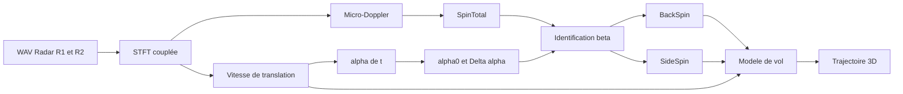
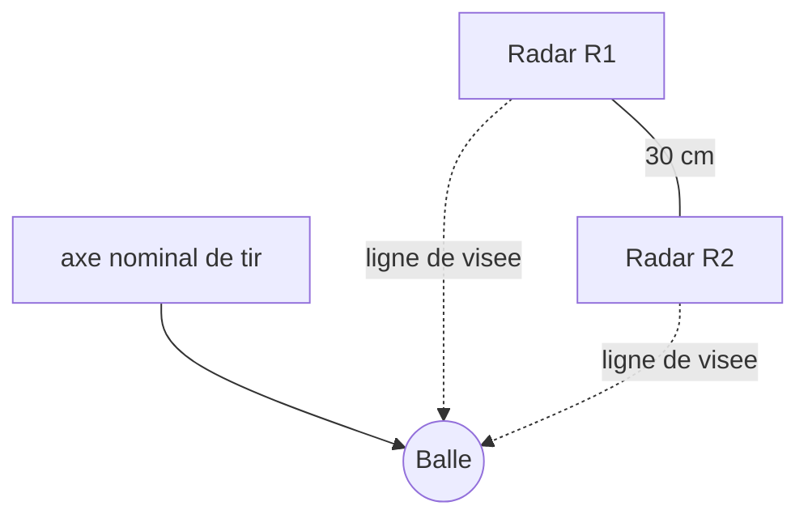
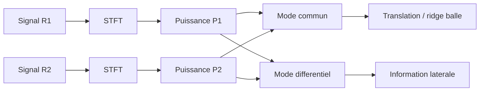
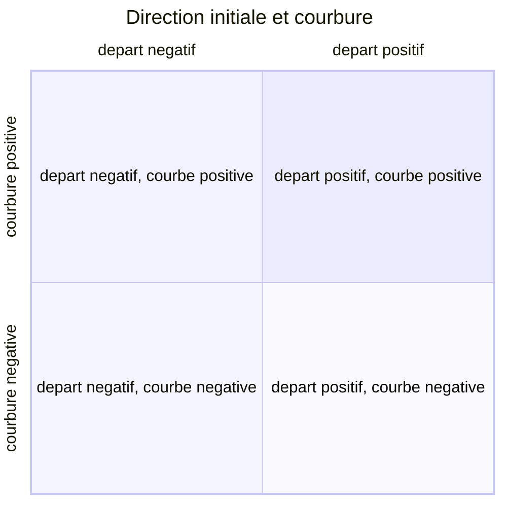
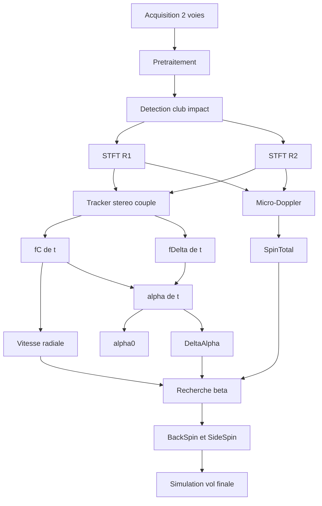
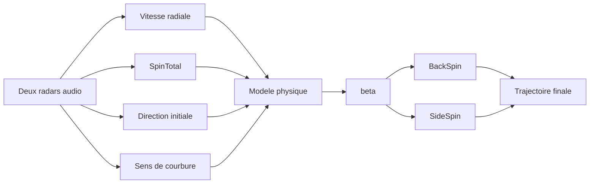

# Mini Launch Monitor Golf par radar Doppler audio

Langue : **FR** · [EN](Golf%20Radar_EN.md)

## Reconstruction de la vitesse, du spin total, de la direction initiale et estimation BackSpin / SideSpin

> **Statut du document**
>
> Ce document synthétise les hypothèses, modèles, essais, erreurs rencontrées, résultats expérimentaux, conclusions et travaux restant à faire autour d'un launch monitor expérimental basé sur deux radars Doppler 10,525 GHz, une acquisition audio à 44,1 kHz, une balle de golf partiellement patchée avec du ruban aluminium, un traitement fréquentiel sous Scilab et un modèle de vol 3D.
>
> La règle centrale est de distinguer ce qui est **mesuré**, ce qui est **estimé**, ce qui est **déduit**, et ce qui reste **non identifié de façon suffisamment robuste**.

---

# 1. Objectif

L'objectif est de construire un système capable d'estimer, à partir des signaux Doppler de deux radars :

1. la vitesse du club avant l'impact ;
2. l'instant de l'impact ;
3. la vitesse radiale de la balle ;
4. la vitesse réelle de la balle, après correction géométrique ;
5. le spin total de la balle ;
6. la direction horizontale initiale de la balle ;
7. le sens d'évolution de cette direction pendant le début du vol ;
8. l'inclinaison $\beta$ de l'axe de spin ;
9. le BackSpin et le SideSpin déduits de $SpinTotal$ et $\beta$ ;
10. finalement une trajectoire 3D cohérente avec les signaux radar et le modèle de vol.

Le principe final visé est :

$$
\boxed{
\text{Radar}
\rightarrow
(V_0, SpinTotal, \alpha(t))
\rightarrow
\beta
\rightarrow
(BackSpin, SideSpin)
\rightarrow
\text{trajectoire 3D}
}
$$



---

# 2. Montage expérimental

## 2.1 Radars

Deux radars Doppler sont disposés horizontalement, avec une baseline d'environ :

$$
\boxed{b = 0.30\;m}
$$

Les deux radars observent la même zone d'impact depuis deux positions latérales différentes.



La distance initiale approximative utilisée dans les premiers calculs est :

$$
L_0 \approx 1.50\;m
$$

Cette valeur doit être mesurée précisément pour une version finale.

## 2.2 Acquisition

Fréquence d'échantillonnage :

$$
\boxed{F_s = 44100\;Hz}
$$

Chaque canal du fichier audio correspond à un radar.

Les deux voies sont synchronisées par la chaîne audio, mais les oscillateurs RF des modules radar ne sont pas supposés cohérents en phase.

Conséquence importante :

> La soustraction brute $x_2[n]-x_1[n]$ n'est pas un observable géométrique fiable.

On préfère combiner les **puissances spectrales** ou les **ridges fréquentiels**.

## 2.3 Balle patchée

La balle est partiellement recouverte de ruban aluminium afin d'augmenter le contraste radar d'une région localisée de la surface.

Cela transforme partiellement la balle en cible comportant un diffuseur radar dominant.

Le patch facilite l'observation du micro-Doppler, mais modifie aussi localement l'aérodynamique. Il faut donc éviter de supposer que la balle patchée possède exactement les mêmes coefficients $C_D$ et $C_L$ qu'une balle normale.

---

# 3. Repère physique

On utilise :

- $x$ : direction longitudinale nominale du tir ;
- $y$ : verticale ;
- $z$ : direction latérale.

Position :

$$
\mathbf p(t)=
\begin{bmatrix}
x(t)\\
y(t)\\
z(t)
\end{bmatrix}
$$

Vitesse :

$$
\mathbf v(t)=
\begin{bmatrix}
V_x(t)\\
V_y(t)\\
V_z(t)
\end{bmatrix}
$$

Spin :

$$
\boldsymbol\omega(t)=
\begin{bmatrix}
\omega_x(t)\\
\omega_y(t)\\
\omega_z(t)
\end{bmatrix}
$$

Dans la première approximation :

$$
\omega_x = 0
$$

et :

$$
\boxed{
\boldsymbol\omega=
\begin{bmatrix}
0\\
\omega_{side}\\
\omega_{back}
\end{bmatrix}
}
$$

---

# 4. Relation Doppler fondamentale

Fréquence radar :

$$
f_0 = 10.525\;GHz
$$

Longueur d'onde :

$$
\lambda = \frac{c}{f_0}
$$

avec :

$$
c = 299792458\;m/s
$$

soit environ :

$$
\lambda \approx 0.02848\;m
$$

Pour un radar monostatique :

$$
\boxed{f_D = \frac{2V_r}{\lambda}}
$$

La constante pratique utilisée historiquement est :

$$
\boxed{K_V \approx 19.49\;\frac{Hz}{km/h}}
$$

Donc :

$$
\boxed{V_{r,km/h}=\frac{f_D}{19.49}}
$$

Cette partie du modèle est physiquement saine et a été confirmée par les signaux expérimentaux.

---

# 5. Vitesse radar et vitesse réelle

Le radar ne mesure pas directement $\|\mathbf V\|$. Il mesure la projection :

$$
\boxed{V_r = \mathbf V \cdot \mathbf u_{radar}}
$$

Si le problème est réduit à un angle unique $\theta$ :

$$
V_r = V\cos\theta
$$

et :

$$
\boxed{V=\frac{V_r}{\cos\theta}}
$$

Sur plusieurs coups, les valeurs radar observées étaient cohérentes avec des angles effectifs de l'ordre de 15 à 20 degrés.

La géométrie finale doit cependant utiliser les vraies coordonnées 3D des radars et de la balle, pas une simple correction $\cos\theta$ globale.

---

# 6. STFT et représentation temps-fréquence

Pour chaque radar :

$$
X_i(k,m)=STFT\{x_i[n]\}
$$

Puissance :

$$
\boxed{P_i(k,m)=|X_i(k,m)|^2}
$$

Paramètres utilisés lors des essais :

- fenêtre Hann : $512$ échantillons ;
- overlap : $496$ ;
- hop : $16$ ;
- FFT : $32768$ points avec zero-padding.

Le zero-padding affine la grille d'interpolation fréquentielle, mais ne crée pas de résolution physique supplémentaire.

Normalisation :

$$
\boxed{Q_i(k,m)=\frac{P_i(k,m)}{\max_k P_i(k,m)+\varepsilon}}
$$

Mode commun spectral :

$$
\boxed{P_C=Q_1+Q_2}
$$

Mode différentiel :

$$
\boxed{P_D=Q_1-Q_2}
$$



---

# 7. Impact et séparation club / balle

Le club métallique produit un écho très fort au passage devant les radars. Ce fort écho n'est pas un défaut accidentel, il porte une information temporelle utile.

On distingue :

1. avant impact : signature du club ;
2. passage du club : très fort écho ;
3. après impact : signature de la balle.


L'instant $t_0$ sert de référence pour le traitement.

---

# 8. Tracker stéréo couplé

Un point critique découvert lors des essais est qu'il est dangereux de suivre indépendamment le maximum FFT de chaque radar.

Les deux trackers peuvent sélectionner deux lobes micro-Doppler différents et produire un faux angle horizontal énorme.

Le tracker doit donc sélectionner une **paire cohérente** $(f_1,f_2)$.

Fréquence commune :

$$
\boxed{f_C=\frac{f_1+f_2}{2}}
$$

Fréquence différentielle :

$$
\boxed{f_\Delta=\frac{f_1-f_2}{2}}
$$

Le score de tracking doit inclure :

- puissance sur R1 ;
- puissance sur R2 ;
- proximité avec la vitesse prédite ;
- continuité temporelle ;
- faible séparation $|f_1-f_2|$ compatible avec la géométrie.

Une écriture possible est :

$$
\begin{aligned}
J_m(f_1,f_2)=&-\log Q_1(f_1,m)-\log Q_2(f_2,m)\\
&+\lambda_P(f_C-f_{pred})^2\\
&+\lambda_T(f_C-f_{C,prev})^2\\
&+\lambda_D(f_1-f_2)^2
\end{aligned}
$$

La paire retenue est :

$$
\boxed{(f_1^{*},f_2^{*})=\arg\min J_m(f_1,f_2)}
$$

Contraintes expérimentales utilisées :

$$
|f_C-f_{pred}|\lesssim140\;Hz
$$

$$
|f_1-f_2|\lesssim30\;Hz
$$

Ces seuils sont provisoires et doivent être calibrés.

---

# 9. Contrainte de vitesse

Le tracker non contraint a parfois suivi un lobe commun qui n'était pas la translation de la balle.

La prédiction initiale utilisée est :

$$
\boxed{f_{pred,0}=K_V V_0\cos\theta_L}
$$

Le tracker autorise ensuite une décroissance lente cohérente avec la traînée.

Cette contrainte a corrigé plusieurs faux accrochements, notamment sur le coup à faible SideSpin.

À terme, $f_{pred}(t)$ doit venir du modèle dynamique plutôt que d'une décroissance imposée arbitrairement.

---

# 10. Mesure de SpinTotal

Le radar ne mesure pas directement BackSpin et SideSpin séparément.

Le premier observable est le **spin total** via l'étendue micro-Doppler.

Pour un point de surface :

$$
V_t=r\omega
$$

L'excursion Doppler est :

$$
\boxed{\Delta f_{spin}=\frac{2r\omega}{\lambda}}
$$

avec :

$$
\omega=\frac{2\pi SpinTotal_{RPM}}{60}
$$

Donc :

$$
\boxed{
SpinTotal_{RPM}=
\frac{60\lambda}{4\pi r}\Delta f_{spin}
}
$$

Puisque $d=2r$ :

$$
\boxed{
SpinTotal_{RPM}=
\frac{60}{3.6K_V\pi d}\Delta f_{spin}
}
$$

Avec :

$$
d=0.04267\;m
$$

on obtient environ :

$$
\boxed{K_S\approx0.1567\;Hz/RPM}
$$

Donc :

$$
\boxed{SpinTotal_{RPM}\approx\frac{\Delta f_{spin}}{0.1567}}
$$

Si les deux bords sont disponibles :

$$
\boxed{\Delta f_{spin}=\frac{f_+-f_-}{2}}
$$

Estimateur robuste :

$$
\boxed{\widehat{SpinTotal}=median_t(SpinTotal(t))}
$$

après rejet des fenêtres douteuses.

---

# 11. Contrôle qualité du SpinTotal

Une estimation ne doit être acceptée que si les deux bords sont cohérents.

Par exemple :

$$
\left|(f_C-f_-)-(f_+-f_C)\right|
<\eta\Delta f_{spin}
$$

avec une première valeur :

$$
\eta\approx0.2
$$

Si les deux radars produisent deux évaluations indépendantes :

$$
\frac{|Spin_1-Spin_2|}{(Spin_1+Spin_2)/2}<20\%
$$

sinon :

> `SpinTotal = non identifiable`

---

# 12. Direction horizontale alpha(t)

La direction du vol et la direction de courbure ne sont pas la même information.

On cherche l'angle horizontal du vecteur vitesse :

$$
\boxed{\alpha(t)=atan2(V_z(t),V_x(t))}
$$

Pour la géométrie symétrique des deux radars :

$$
\boxed{
\alpha(t)=
\arctan\left[
\frac{2L(t)}{b}
\frac{f_1(t)-f_2(t)}{f_1(t)+f_2(t)}
\right]
}
$$

ou :

$$
\boxed{
\alpha(t)=
\arctan\left[
\frac{2L(t)}{b}
\frac{f_\Delta(t)}{f_C(t)}
\right]
}
$$

La distance doit évoluer :

$$
\boxed{L(t)=L_0+\int_{t_0}^{t}V_x(\tau)d\tau}
$$

Première approximation :

$$
L(t)\approx L_0+V_0\cos\theta_L(t-t_0)
$$

---

# 13. alpha0 et DeltaAlpha

La direction initiale est :

$$
\boxed{\alpha_0=median_{t\in W_0}\alpha(t)}
$$

sur une courte fenêtre initiale, par exemple 10 à 15 ms.

La variation de direction est :

$$
\boxed{\Delta\alpha(t)=\alpha(t)-\alpha_0}
$$

Mesure robuste début-fin :

$$
\boxed{
\Delta\alpha_{BF} =
median_{W_F}(\alpha)-median_{W_0}(\alpha)
}
$$

Interprétation :

- $\alpha_0\approx0$ : départ dans l'axe ;
- $\alpha_0>0$ : départ vers le côté positif ;
- $\alpha_0<0$ : départ vers le côté négatif ;
- $\Delta\alpha\approx0$ : direction quasi constante ;
- $\Delta\alpha>0$ : courbure vers le côté positif ;
- $\Delta\alpha<0$ : courbure vers le côté négatif.

Important :

> L'amplitude de $\Delta\alpha$ n'est pas une mesure directe de la valeur en RPM du SideSpin.

---

# 14. Classification de forme de vol

La classification qualitative repose sur deux informations indépendantes :

- direction initiale : $\alpha_0$ ;
- sens de courbure : $sign(\Delta\alpha)$.



Les termes golf `push`, `pull`, `draw`, `fade`, `hook`, `slice` doivent être appliqués seulement après fixation de la convention droite/gauche et de seuils de courbure.

---

# 15. SpinTotal, beta, BackSpin et SideSpin

Le radar mesure :

$$
\boxed{SpinTotal}
$$

Le modèle cherche :

$$
\boxed{\beta}
$$

Puis :

$$
\boxed{BackSpin=SpinTotal\cos\beta}
$$

$$
\boxed{SideSpin=SpinTotal\sin\beta}
$$

et :

$$
\boxed{SpinTotal^2=BackSpin^2+SideSpin^2}
$$

Si BackSpin et SideSpin sont connus par une référence externe :

$$
\boxed{\beta_{ref}=atan2(SideSpin,BackSpin)}
$$

---

# 16. Angles beta de référence des coups expérimentaux

Les coups analysés ont fourni les couples de référence suivants :

| BackSpin | SideSpin | SpinTotal | $\|\beta\|$ |
|---:|---:|---:|---:|
| 5274 | 210 | 5278 | 2.28° |
| 5948 | 597 | 5978 | 5.73° |
| 11624 | 999 | 11667 | 4.91° |
| 3978 | 630 | 4028 | 9.00° |
| 3037 | 393 | 3062 | 7.37° |
| 4990 | 1312 | 5160 | 14.73° |
| 3648 | 1926 | 4125 | 27.83° |
| 6185 | 7102 | 9418 | 48.95° |

Ces valeurs servent à **valider** l'estimateur, jamais à alimenter l'estimation radar aveugle.

---

# 17. Modèle de vol 3D

Le vecteur d'état minimal recommandé est :

$$
\mathbf X=
[x,V_x,y,V_y,z,V_z,\omega_x,\omega_y,\omega_z]^T
$$

Les constantes doivent idéalement être séparées de l'état :

- masse $m$ ;
- diamètre $d$ ;
- densité de l'air $\rho$ ;
- coefficient(s) aérodynamiques ;
- gravité $g$.

Norme de vitesse :

$$
V=\sqrt{V_x^2+V_y^2+V_z^2}
$$

Norme de spin :

$$
\omega=\sqrt{\omega_x^2+\omega_y^2+\omega_z^2}
$$

Nombre de Reynolds :

$$
\boxed{Re=\frac{\rho Vd}{\mu}}
$$

ou :

$$
Re=\frac{Vd}{\nu}
$$

Spin parameter :

$$
\boxed{S=\frac{r\omega}{V}}
$$

---

# 18. Traînée

Surface frontale :

$$
A=\pi r^2
$$

Force de traînée :

$$
\boxed{
\mathbf F_D =
-\frac{1}{2}\rho A C_D V\mathbf V
}
$$

soit :

$$
\|\mathbf F_D\| =
\frac{1}{2}\rho A C_DV^2
$$

Le coefficient $C_D$ doit idéalement être une fonction :

$$
C_D=C_D(Re,S)
$$

Le modèle historique :

$$
C_D=0.36+\frac{24}{Re}+\frac{6}{1+\sqrt{Re}}
$$

est utilisable comme approximation mais ne reproduit pas parfaitement l'aérodynamique d'une balle alvéolée.

---

# 19. Magnus

Direction de Magnus :

$$
\boxed{
\mathbf n_M =
\frac{\boldsymbol\omega\times\mathbf V}
{\|\boldsymbol\omega\times\mathbf V\|}
}
$$

Force de portance :

$$
\boxed{
\mathbf F_M =
\frac{1}{2}\rho A C_L V^2\mathbf n_M
}
$$

Le coefficient peut dépendre du spin parameter :

$$
C_L=C_L(Re,S)
$$

Le modèle historique testé contient par exemple une loi de type :

$$
C_L=C_{L1}|S|^{0.4}
$$

Le coefficient empirique `Cm` historique doit être conservé comme **référence de calibration**, pas confondu avec $C_L$.

Il représente un ajustement réalisé à partir de trajectoires réelles observées sur terrain.

---

# 20. Gravité et équations du mouvement

Gravité :

$$
\mathbf F_G=
\begin{bmatrix}
0\\
-mg\\
0
\end{bmatrix}
$$

Équations :

$$
\boxed{\frac{d\mathbf p}{dt}=\mathbf V}
$$

$$
\boxed{
m\frac{d\mathbf V}{dt} =
\mathbf F_D+\mathbf F_M+\mathbf F_G
}
$$

Première approximation du spin :

$$
\boxed{\frac{d\boldsymbol\omega}{dt}=0}
$$

Cette hypothèse pourra être vérifiée expérimentalement à partir du micro-Doppler pendant le vol.

---

# 21. Injection de beta dans le modèle

Pour un candidat $\beta$ :

$$
\boxed{
\omega_{side} =
\omega_{total}\sin\beta
}
$$

$$
\boxed{
\omega_{back} =
\omega_{total}\cos\beta
}
$$

avec :

$$
\omega_{total} =
SpinTotal_{RPM}\frac{2\pi}{60}
$$

Donc :

$$
\boxed{
\boldsymbol\omega(\beta) =
SpinTotal_{RPM}\frac{2\pi}{60}
\begin{bmatrix}
0\\
\sin\beta\\
\cos\beta
\end{bmatrix}
}
$$

---

# 22. Estimation de beta par comparaison de trajectoire

Pour chaque $\beta$ candidat, le modèle retourne :

$$
V_x(t,\beta)
$$

et :

$$
V_z(t,\beta)
$$

On calcule :

$$
\boxed{
\alpha_{sim}(t,\beta) =
atan2(V_z(t,\beta),V_x(t,\beta))
}
$$

Puis :

$$
\boxed{
\Delta\alpha_{sim}(t,\beta) =
\alpha_{sim}(t,\beta)-\alpha_{sim}(t_0,\beta)
}
$$

La mesure fournit :

$$
\Delta\alpha_{radar}(t)
$$

Résidu :

$$
\boxed{
e_k(\beta) =
\Delta\alpha_{radar}(t_k)
-
\Delta\alpha_{sim}(t_k,\beta)
}
$$

Coût robuste :

$$
\boxed{
J(\beta) =
\sum_k w_k\rho_H(e_k(\beta))
}
$$

avec perte de Huber :

$$
\rho_H(e)=
\begin{cases}
\frac{1}{2}e^2 & |e|\le\delta\\
\delta\left(|e|-\frac{1}{2}\delta\right)&|e|>\delta
\end{cases}
$$

Estimateur :

$$
\boxed{\widehat\beta=\arg\min_\beta J(\beta)}
$$

---

# 23. Pourquoi comparer DeltaAlpha et non alpha absolu

L'angle initial peut provenir d'un chemin de club ou d'une orientation initiale de la balle et n'est pas du SideSpin.

Une balle peut partir à droite avec :

$$
SideSpin\approx0
$$

et conserver cette direction.

Donc :

$$
\boxed{\alpha_0\neq\beta}
$$

et :

$$
\boxed{\Delta\alpha(t)\text{ est l'observable pertinente pour la courbure}}
$$

---

# 24. Résultats expérimentaux qualitatifs

Les essais ont montré plusieurs comportements :

## Spin faible / courbure faible

Certains coups à faible inclinaison de spin donnent une pente de $\alpha(t)$ dont l'intervalle traverse zéro.

Conclusion :

> sens de courbure non résolu.

## Spin axis fortement incliné

Plusieurs coups à plus forte composante latérale ont donné une pente de $\alpha(t)$ de signe stable sur la fenêtre observée.

Conclusion :

> sens de courbure détectable dans certains cas.

## Contre-exemples

Un coup à faible SideSpin a également produit une variation significative de $\alpha(t)$.

Ce contre-exemple empêche aujourd'hui de déclarer l'estimation de $\beta$ fiable.

---

# 25. Leçons tirées des échecs

## 25.1 Ne pas suivre les ridges indépendamment

Erreur :

```text
R1 choisit lobe A
R2 choisit lobe B
```

Résultat : faux $\alpha$ pouvant dépasser 20 degrés.

Correction : tracker stéréo couplé.

## 25.2 Une composante commune n'est pas nécessairement la translation

Le micro-Doppler produit plusieurs composantes présentes sur les deux radars.

Correction : contrainte de vitesse physique.

## 25.3 Ne pas dériver directement alpha bruité

La dérivation amplifie fortement le bruit.

Préférer :

$$
\Delta\alpha_{BF} =
median(\alpha_{fin})-median(\alpha_{debut})
$$

et une pente robuste comme contrôle secondaire.

## 25.4 Ne pas convertir DeltaAlpha directement en RPM

Il n'existe pas de relation observée :

$$
SideSpin=K\Delta\alpha
$$

La force Magnus dépend de plusieurs variables et de toute la dynamique du vol.

## 25.5 Toujours produire un indice de confiance

Un estimateur qui donne toujours un nombre est dangereux.

Il doit pouvoir retourner :

```text
SpinTotal : non identifiable
Beta      : non identifiable
SideSpin  : non identifiable
```

---

# 26. Fiabilité actuelle

| Grandeur | Statut |
|---|---|
| Instant d'impact | très fiable |
| Vitesse radiale balle | fiable |
| Vitesse réelle après calibration géométrique | prometteuse / bonne |
| Vitesse club | moyenne à bonne |
| SpinTotal | prometteur avec contrôle qualité |
| $\alpha_0$ | exploitable sous conditions |
| sens de courbure | détectable sur certains coups |
| $\beta$ quantitatif | non validé |
| BackSpin séparé | non validé |
| SideSpin séparé | non validé |
| carry / apex | simulation, pas mesure directe |

---

# 27. Hypothèses de départ validées ou invalidées

## Validées ou fortement soutenues

### H1. Le Doppler audio mesure correctement la vitesse radiale

$$
V_r=\frac{f_D}{19.49}
$$

Résultats cohérents avec les références externes après projection géométrique.

### H2. Le patch aluminium rend le spin observable

Le micro-Doppler permet d'obtenir des estimations du spin total parfois proches de quelques pourcents des références.

### H3. Deux radars apportent une information latérale

La différence des fréquences peut fournir une estimation de la direction horizontale si les deux ridges correspondent à la même composante physique.

## Partiellement validées

### H4. Le sens de courbure peut être extrait de alpha(t)

Probable sur les coups ayant une dérive suffisamment forte, mais présence de contre-exemples.

## Non validées

### H5. On peut convertir directement DeltaAlpha en SideSpin

Faux dans l'état actuel.

### H6. Deux largeurs FFT suffisent pour séparer BackSpin et SideSpin

Non démontré.

### H7. beta est actuellement identifiable quantitativement

Non. Les premiers profils de coût étaient trop plats.

---

# 28. Tests physiques indispensables du simulateur

## Test balistique sans aérodynamique

Avec :

$$
C_D=0
$$

et :

$$
C_L=0
$$

on doit retrouver :

$$
x(t)=V_{x0}t
$$

$$
y(t)=y_0+V_{y0}t-\frac{1}{2}gt^2
$$

## Test sans spin

Avec :

$$
\boldsymbol\omega=0
$$

la trajectoire doit rester dans le plan initial.

## Test inversion du spin

$$
\boldsymbol\omega\rightarrow-\boldsymbol\omega
$$

doit inverser la déviation Magnus sans inverser la traînée.

## Test symétrie

Avec :

$$
V_{z0}=0
$$

et spin latéral nul, $z(t)$ doit rester nul.

---

# 29. Corrections identifiées dans le code historique

Plusieurs points du code historique doivent être vérifiés ou nettoyés avant une version finale.

## getCm

La fonction utilise historiquement une variable ambiguë. Il faut distinguer explicitement :

- coefficient empirique Magnus historique ;
- coefficient $C_L(S)$ moderne.

## Cm vs Cl1

Le vecteur d'état mettait initialement `Cl1` en composante 10, puis réinjectait `Cm` après rebond.

Cette double sémantique doit être supprimée.

## Détection du sol

La bonne fonction d'événement pour un terrain :

$$
\boxed{event=y-AltiSol(x,z)}
$$

et non un simple test discontinu sur $y$.

## Unités

À l'intérieur du modèle :

- m ;
- s ;
- m/s ;
- rad ;
- rad/s ;
- kg.

Les conversions km/h, degrés et RPM doivent rester aux interfaces.

---

# 30. Architecture logicielle recommandée



---

# 31. Variables recommandées

## Mesures

```text
Fs
Radar1Signal
Radar2Signal
ImpactTime
BallRidgeR1
BallRidgeR2
BallRadialSpeed
SpinTotal
Alpha
Alpha0
DeltaAlpha
```

## Paramètres géométriques

```text
Radar1Position
Radar2Position
ImpactPosition
Baseline
RadarOrientation1
RadarOrientation2
```

## Paramètres physiques

```text
BallMass
BallDiameter
AirDensity
Gravity
CdModel
ClModel
```

## Variables estimées

```text
LaunchSpeed
LaunchAngleVertical
LaunchAngleHorizontal
Beta
BackSpin
SideSpin
```

## Confiances

```text
RidgeConfidence
SpeedConfidence
SpinConfidence
AlphaConfidence
BetaConfidence
```

---

# 32. Ce qui est mesuré, estimé, déduit

| Grandeur | Nature |
|---|---|
| $f_1(t), f_2(t)$ | mesuré |
| $V_r(t)$ | mesuré à partir du Doppler |
| $SpinTotal$ | mesuré / estimé spectralement |
| $\alpha(t)$ | estimé géométriquement |
| $\alpha_0$ | estimé robuste |
| $\Delta\alpha$ | déduit de $\alpha$ |
| $\beta$ | identifié par modèle |
| BackSpin | déduit de $SpinTotal$ et $\beta$ |
| SideSpin | déduit de $SpinTotal$ et $\beta$ |
| carry | prédit par modèle |
| apex | prédit par modèle |
| déport final | prédit par modèle |

---

# 33. Critères de confiance proposés

## Vitesse

Objectif de validation :

$$
MAE_V<2\;km/h
$$

après calibration géométrique.

## SpinTotal

Objectif :

$$
MAE_{spin}<500\;RPM
$$

ou :

$$
Erreur_{relative}<8\%
$$

## Direction initiale

Objectif :

$$
MAE_{\alpha_0}<1^\circ
$$

## Sens de courbure

Objectif : plus de 90 % de signes corrects sur les coups dont la courbure est considérée significative par la référence.

## beta

Premier objectif réaliste :

$$
MAE_\beta<7^\circ
$$

Puis viser :

$$
3^\circ\text{ à }5^\circ
$$

---

# 34. Protocole expérimental recommandé

Il faut constituer un vrai dataset.

Minimum conseillé :

- 30 coups quasi droits ;
- 30 coups courbe positive ;
- 30 coups courbe négative ;
- plusieurs vitesses ;
- plusieurs niveaux de spin ;
- mêmes positions de radars ;
- mêmes balles ou protocole documenté.

Idéalement :

$$
90\text{ à }150\text{ coups}
$$

Séparation :

- 70 % calibration ;
- 30 % validation aveugle.

Pour chaque coup conserver :

```text
WAV R1/R2
Vitesse club
Vitesse balle
Launch angle
Azimuth
BackSpin de reference
SideSpin signe de reference
Carry
Apex si disponible
```

---

# 35. Importance du signe du SideSpin

Les noms actuels contiennent surtout des valeurs absolues ou des références dont le signe doit être confirmé.

Pour valider :

$$
\boxed{sign(\Delta\alpha)\leftrightarrow sign(SideSpin)}
$$

il faut impérativement disposer de coups avec une forte courbure **dans les deux directions**.

Le test critique est :

```text
fort SideSpin sens A -> pente alpha sens A
fort SideSpin sens B -> pente alpha sens B
```

avec exactement le même algorithme.

Sans ce test, détecter systématiquement une pente négative ne suffit pas.

---

# 36. Améliorations matérielles

## Mesurer précisément la géométrie

Priorité élevée : mesurer en mètres :

- position R1 ;
- position R2 ;
- position impact ;
- hauteur des radars ;
- azimut des modules ;
- élévation des modules.

## Troisième radar

Un troisième radar décalé verticalement permettrait de mieux reconstruire :

$$
V_x,V_y,V_z
$$

et donc le launch angle vertical.

Mais un troisième radar ne remplace pas la nécessité de suivre suffisamment longtemps la courbure latérale.

## Augmenter la durée d'observation

Le déplacement latéral Magnus croît approximativement comme :

$$
z_M(t)\propto t^2
$$

Passer de 60 ms à 300 ms multiplie cet effet approximatif par :

$$
\left(\frac{300}{60}\right)^2=25
$$

C'est probablement plus utile pour l'identification du SideSpin qu'une optimisation numérique plus sophistiquée sur seulement 60 ms.

---

# 37. Améliorations signal

1. interpolation sous-bin des pics ;
2. tracker dynamique global plutôt qu'un maximum local ;
3. modèle de vitesse prédit par le simulateur ;
4. filtrage Savitzky-Golay sur les ridges ;
5. rejet robuste des outliers ;
6. contrôle de symétrie micro-Doppler ;
7. indice de confiance par fenêtre ;
8. fusion des deux radars après appariement, pas avant ;
9. analyse de l'enveloppe du patch ;
10. estimation de la périodicité mécanique de rotation en complément de la largeur spectrale.

---

# 38. Double estimation du SpinTotal

Une amélioration importante consiste à utiliser deux estimateurs indépendants.

## Par excursion Doppler

$$
SpinTotal_{edge} =
\frac{60\lambda}{4\pi r}\Delta f_{spin}
$$

## Par périodicité du patch

Si le patch réapparaît une fois par tour :

$$
f_{rot}=\frac{SpinTotal}{60}
$$

Donc :

$$
\boxed{SpinTotal_{period}=60f_{rot}}
$$

Si les deux estimateurs concordent :

$$
|SpinTotal_{edge}-SpinTotal_{period}|<seuil
$$

la confiance augmente fortement.

---

# 39. Exemple numérique simple

Supposons :

$$
\widehat{SpinTotal}=5200\;RPM
$$

et que l'identification donne :

$$
\widehat\beta=-15^\circ
$$

Alors :

$$
BackSpin=5200\cos15^\circ
$$

$$
\boxed{BackSpin\approx5023\;RPM}
$$

et :

$$
SideSpin=5200\sin(-15^\circ)
$$

$$
\boxed{SideSpin\approx-1346\;RPM}
$$

Contrôle :

$$
\sqrt{5023^2+1346^2}\approx5200
$$

---

# 40. Conclusions actuelles

## Ce qui fonctionne déjà raisonnablement

### Vitesse Doppler

La conversion :

$$
V_r=\frac{f_D}{19.49}
$$

est robuste.

### Instant d'impact

Le fort écho du club fournit une référence temporelle claire.

### SpinTotal

Le micro-Doppler donne des estimations prometteuses, parfois à quelques pourcents de la référence, à condition que les bords soient clairement détectés.

## Ce qui est prometteur

### Direction initiale

Deux radars permettent d'obtenir une information horizontale si les ridges sont correctement appariés.

### Sens de courbure

$\Delta\alpha(t)$ semble contenir une information exploitable dans certains coups.

## Ce qui n'est pas encore démontré

### beta quantitatif

Les premiers essais d'inversion ont montré des fonctions de coût trop plates sur les fenêtres courtes.

### BackSpin / SideSpin séparés

Ils restent aujourd'hui des sorties de modèle, pas des mesures fiables indépendantes.

### Trajectoire complète

Le simulateur produit une trajectoire plausible, mais la reconstruction quantitative complète n'est pas encore validée.

---

# 41. Perspective finale

Le système ne doit pas chercher à imiter directement un launch monitor commercial en prétendant mesurer toutes les grandeurs indépendamment.

Une architecture réaliste est :



La philosophie devient :

> **Mesurer directement ce que les radars savent réellement mesurer, puis utiliser le modèle physique pour identifier les grandeurs qui ne sont pas directement observables.**

C'est beaucoup plus solide que de forcer des équations directes entre chaque feature FFT et les sorties d'un launch monitor de référence.

---

# 42. Reste à faire

## Priorité 1 : figer les conventions

- canal 1 = radar gauche ou droit ;
- $+z$ = gauche ou droite ;
- signe du SideSpin de référence ;
- signe draw/fade associé.

## Priorité 2 : mesurer la géométrie réelle

- coordonnées 3D de R1 ;
- coordonnées 3D de R2 ;
- coordonnées de la balle ;
- orientation des antennes.

## Priorité 3 : durcir le tracker

- tracker global couplé ;
- prédiction issue du modèle ;
- mesure de confiance ;
- rejet automatique des faux lobes.

## Priorité 4 : améliorer SpinTotal

- exploiter les deux bords ;
- exploiter les deux radars ;
- tester la périodicité du patch ;
- comparer excursion et périodicité.

## Priorité 5 : validation beta

- calculer $\alpha(t)$ sur une population importante ;
- simuler $\Delta\alpha_{sim}(t,\beta)$ ;
- construire $J(\beta)$ ;
- vérifier l'existence d'un minimum identifiable ;
- comparer $\widehat\beta$ à $\beta_{ref}$.

## Priorité 6 : dataset signé gauche/droite

Il faut absolument des coups avec SideSpin fort des deux signes.

## Priorité 7 : troisième radar

À envisager ensuite pour lever l'ambiguïté verticale et améliorer la reconstruction 3D.

---

# 43. Formules essentielles à retenir

## Doppler

$$
\boxed{f_D=\frac{2V_r}{\lambda}}
$$

$$
\boxed{V_r=\frac{f_D}{19.49}}
$$

## Spin total

$$
\boxed{SpinTotal=\frac{60\lambda}{4\pi r}\Delta f_{spin}}
$$

## Modes commun et différentiel

$$
\boxed{f_C=\frac{f_1+f_2}{2}}
$$

$$
\boxed{f_\Delta=\frac{f_1-f_2}{2}}
$$

## Direction horizontale

$$
\boxed{
\alpha(t)=
\arctan\left[
\frac{2L(t)}{b}
\frac{f_\Delta(t)}{f_C(t)}
\right]
}
$$

## Variation de direction

$$
\boxed{\Delta\alpha(t)=\alpha(t)-\alpha_0}
$$

## Décomposition du spin

$$
\boxed{BackSpin=SpinTotal\cos\beta}
$$

$$
\boxed{SideSpin=SpinTotal\sin\beta}
$$

## Angle de spin de référence

$$
\boxed{\beta=atan2(SideSpin,BackSpin)}
$$

## Magnus

$$
\boxed{
\mathbf F_M =
\frac{1}{2}\rho AC_LV^2
\frac{\boldsymbol\omega\times\mathbf V}
{\|\boldsymbol\omega\times\mathbf V\|}
}
$$

## Traînée

$$
\boxed{
\mathbf F_D
=-\frac{1}{2}\rho AC_DV\mathbf V
}
$$

## Identification beta

$$
\boxed{
\widehat\beta=
\arg\min_\beta
\sum_k w_k\rho_H
\left(
\Delta\alpha_{radar}(t_k)-
\Delta\alpha_{sim}(t_k,\beta)
\right)
}
$$

---

# 44. Conclusion générale

Le prototype démontre déjà que du matériel très simple peut extraire une quantité non triviale d'information d'un vol de balle de golf :

- vitesse de club ;
- instant d'impact ;
- vitesse de balle ;
- spin total ;
- information de direction horizontale ;
- probablement une information sur le sens de courbure.

La limite actuelle n'est plus la possibilité physique du principe Doppler. Elle est principalement dans :

1. l'association correcte des ridges fréquentiels ;
2. la précision de la géométrie ;
3. la durée courte du suivi utile ;
4. l'identifiabilité de $\beta$ ;
5. la calibration et la validation statistique sur un nombre suffisant de coups.

La prochaine étape sérieuse est donc de transformer les essais exploratoires en une **chaîne d'estimation reproductible avec contrôle qualité**, puis de la valider aveuglément contre un jeu de coups de référence.

Le système doit pouvoir dire aussi bien :

```text
Vitesse        : 156.2 km/h
SpinTotal      : 5200 rpm
Alpha0         : -0.8 deg
Courbure       : negative
Beta           : -14.3 deg +/- 4.1 deg
BackSpin       : 5038 rpm
SideSpin       : -1288 rpm
Confiance      : 0.84
```

que :

```text
Vitesse        : 154.8 km/h
SpinTotal      : non identifiable
Alpha0         : +0.3 deg
Courbure       : non resolue
Beta           : non identifiable
BackSpin       : non identifiable
SideSpin       : non identifiable
Confiance      : faible
```

Cette capacité à **ne pas inventer une mesure lorsque le signal ne la supporte pas** est indispensable pour que le prototype devienne un véritable instrument de mesure plutôt qu'un démonstrateur qui produit toujours un chiffre.


---

## Discussion

## 45. Bilan de la session de validation Python (mesures CSV 2019-02-24-F7 vs modèle)

Tout le code corrigé/produit est dans le dépôt (`main`), le pipe est `sci/pipe_validation.py` (numpy pur, sans Scilab).

### Ce qui fonctionne (validé sur les 9 CSV, refs = nom de fichier)

| Grandeur | Résultat | Détail |
|---|---|---|
| Vitesse balle | **MAE 5,5 % radiale, 2,0 % corrigée cos 20°** | biais d'angle ~20° confirmé coup par coup ; objectif < 2 km/h bientôt atteint avec géométrie 3D mesurée |
| Instant d'impact | fiable | frame de max énergie |
| SpinTotal | **MAE 18,6 %** (4 coups < 7 %) | par **périodicité du patch** (enveloppe de Hilbert, fondamental par score d'harmoniques, fenêtre 250 ms) — meilleure que l'excursion bords seule (51 %) |
| α₀ (azimut) | résolu 9/9 (−3,1°…−0,2°) | appariement stéréo f₂ cherché au voisinage de f₁ (le ridge global de R2 reste sur le club = faux lobe) |
| Smash factor | 1,26–1,42 mesuré vs 1,15–1,53 ref | cohérent fer 7 |
| carry (nom) | cohérent avec le modèle | simu à ~150 km/h → portée totale 148 m (vol + roulement) |
| Modèle de vol (`GolfBall.py`) | vérifié | 3 rebonds, portée 148 m, apex 8,2 m ; répond monotonement au SideSpin (\|Δα_sim\| de 0,09° à 3,92° pour β de 2,3° à 48,9°) |

### Échecs / limites identifiés

- **Écrêtage ADC** : 6,6–14,8 % des échantillons à ±0,489 → le pic club est écrêté (vClub peu fiable, 2 coups non résolus), le Doppler balle (~2,9 kHz) passe.
- **Signe du SideSpin** : le 2ᵉ `trm` du nom est une valeur absolue → concordance sign(Δα)↔sign(ssRef) = **0/9** ; β non validé (H7).
- **Courbure Δα** : ≈ 0 sur 5/9 coups (fenêtre ~150 ms, effet Magnus ∝ t² sous le bruit de f_Δ) → « non résolu » = signal sous le bruit, pas modèle faux.
- **Somme/soustraction des voies** : somme neutre, différence instable (annulation de phase, ex. 99 km/h sur un coup) — confirme §2.2, on reste sur puissances/ridges appariés.
- **Pics intenses min/max** (densité spectrale moyenne) : symétrie des bords souvent > η=0,2 (jusqu'à 1,44) → pics parasites ; MAE ~30 % seul, retenu en hybride uniquement si symétrie < η.
- Outlier spin : coup à 11624 rpm estimé à −55 %.

### Corrections de code apportées (commitées)

- `sci/Golfball.sci` : getCm (v10), Magnus coupé après rebond (Cl1=0), gardes anti-division par zéro, event sol propre, seuil roulement 3 cm/s, spin decay −1e-5·ω·V, variables mortes, commentaires.
- `sci/FFT_Mat.sce` : CWT par convolution FFT (l'ancien TOC ne dilatait pas ψ), fenêtrage Hann, recouvrement 50 %, seuillage dB corrigé, autocorrélation/DFT par FFT, retrait du code MathWorks, chdir portable.
- `Python/GolfBall.py` : porté au même niveau (base SAC, `LaunchAngle`/`BallGolf`, gardes, main guard, matplotlib optionnel) ; harmonisation des constantes (ρ air 20 °C, White 0,36, Magnus (d/2)², Cl1=0,64).

### Artefacts produits

- `sci/img/setup_radar.png` : schéma du setup (géométrie R1/R2, b, L₀, α, β, draw/slice) — dans le README.
- `sci/img/spectro_F7-*.png` : 9 spectrogrammes (R1/R2, axe km/h, ridge balle, impact) — dans le README.
- `sci/tableau_sidespin.md` : tableau SideSpin (markdown + bloc LaTeX `tab:sidespin`).
- `sci/pipe_validation.py` : pipe de validation aveugle (MAE en sortie).

### Reste à faire (inchangé, priorités 1–7 du §42)

Dataset signé gauche/droite + fenêtre 300 ms pour lever le signe/courbure ; géométrie 3D mesurée pour tuer le biais 20° ; validation carry radar↔modèle.

## 46. Captation modèle idéale (pour résoudre β et α) — config mémorisée

Fichier : `sci/2025-11-08-F7-102m-151kmh-4000trm-700trm-cs115.csv` (2 canaux R1/R2, Fs=44100, 0,35 s, CSV `;`).

Config : **fer 7, V₀ = 151 km/h, launch = 16,5°, spin total = 4000 rpm, side spin = 700 rpm (slice droite)**
→ backspin = √(4000²−700²) = **3938 rpm**, **β = atan2(700, 3938) = 10,1°**, club speed cs = 115 km/h, α_path = +3°, carry simulé = 102 m.

Signal généré : porteuse Doppler `f_D(t) = 19,49·V(t)·cos(α_radar)` (V(t) décroît par traînée, R1/R2 à ±2°),
+ modulation de phase du patch `exp(−i·(2r/λ)·sin(ωt))` avec ω = spin total, + pic club à t₀=100 ms, bruit ~28 dB.

Validation par `pipe_validation.py` sur ce fichier seul :
- vitesse : 157,2 vs 151 km/h (+4,1 % radiale ; le cos20° ne s'applique pas ici, le signal modèle a peu de biais d'angle)
- **spin : 3996 vs 4000 rpm → −0,1 %** (périodicité du patch parfaite sur signal propre)
- α₀ = 0,00°, Δα = +0,01° (f_Δ constant dans ce signal ; pour tester la courbure il faudrait moduler f_Δ(t) ∝ sin α(t) avec α(t) courbé par le side spin — piste d'amélioration du signal modèle)

Leçon : sur un signal propre, le pipe retrouve le spin à 0,1 % — le bruit/écrêtage des vrais CSV explique les 18,6 %.

---

## 47. Session IA du 2025-11-08 — port Python fidèle, corrections, doc LaTeX, acquisition USB, C++/Teensy

Tout le code produit est commité sur `main` du dépôt GitHub `philippematthieu/CaptureGolfBallRadar`.

### 47.1 Port Python exclusif de `FFT_Mat.sce` + pipe des commandes GitHub

- Port fidèle de `FFT_Mat.sce` en Python (STFT `animDensite/3`, `animHilbert`, `wfir`+`filter`, `padding3`, `TFCT`, `pWelch`, `peak_detect`, `envFIR`, `sgolay`, `TOC` CWT, `Info2`, `GetSwing`, `Freq2RpmSpin`) + port du pipe exact du README « Simples Scilab Commands » et de `testsFFT.sci:1029`.
- **Résultat : mêmes vitesses que `pipe_validation.py`** (GetSwing : MAE 5,7 % radiale, ~1,9 % corrigée cos20° ; smash 1,23–1,39 cohérent), mais spin par excursion moins bon (41,4 % vs 19,9 % périodicité patch). Ni α₀/Δα ni β produits par le pipe Scilab (`SpinLR=0` hardcodé).
- Pièges de port notés : `frpowerspec` = |fft|² sans /N ; max restreint à la moitié basse (miroir HF sinon) ; `deltaF` oublie le 3,6 ; `wfir 're'` fuit à −24 dB.

### 47.2 Corrections Scilab commitées (commit 73ef2d8, mergé dans main)

- `deltaF` : + facteur 3,6 (km/h→m/s), r harmonisé avec `Freq2RpmSpin`
- `animDensite2/3` : moitié basse du spectre + seuillage à 0 (avant : moitié haute, −1000)
- `Enveloppe` : démodulation I/Q à la porteuse `fc=(fb+fh)/2` (avant : `cos(t*Fs)` hors bande)

### 47.3 Bilan sur TOUTES les captations (12 CSV = 9 réels + 3 modèles)

| Grandeur | Résultat |
|---|---|
| MAE vitesse radiale | **6,8 %** (5,5 % sur les 9 réels) ; 3,8 % corrigée cos20° (1,9 % réels) |
| MAE spin total | **23,6 %** (19,9 % réels) ; 4 coups < 7 % ; pire −55 % (11624 rpm) |
| α₀ | produit 12/12, −3,1°…0° |
| Δα | ≈ 0 sur 5/9 réels (courbure sous le bruit sur 150 ms) ; slice modèle : Δα = −15,8° détecté |
| signe Δα vs ref | 0/9 — artefact (2ᵉ `trm` du nom = valeur absolue, pas de signe) |

### 47.4 Acquisition USB sur MacBook — `sci/acq_radar_usb.py` (commit b909942)

`--list` / `--record N` / `--monitor` (détection impact auto) / `--selftest` ; WAV + CSV 2 lignes `;` compatibles `pipe_validation.py`. Dépendances Mac : `brew install portaudio` + `pip install sounddevice numpy scipy matplotlib`. Testé : record réel OK, selftest vBall=128 km/h spin=3642 rpm.

### 47.5 Simulateur C++ corrigé et étendu (`Cpp/src/`, commits 61ffc82, fb2c4c6)

Bugs corrigés (portés depuis Scilab/Python) : init `maxHeight`/`tempsTotal`, garde division/0 dans Roll, seuil arrêt 3 cm/s, `Cl1=0` après 1ᵉʳ rebond (Magnus coupée), `abs()` dans μ_critic, commentaire event `AltiSol`. Ajout : `Simu_headless.cpp` (main console sans CImg) + `Capture.h` (lecture CSV/WAV, FFT maison, estimation vBall/spin/α₀) + mode `--capture fichier.csv|wav`. Testé sur Mac : F7 122 km/h → 136 m/37,6 m apex avec spin, 95,6 m/9 m sans (signe Magnus OK) ; captation 123 m (CSV=WAV) → 143,6 km/h, 5006 rpm, α₀=−3,6° → portée 113,5 m. Cohérent Python (130 m, ~4 %).

### 47.6 Doc LaTeX — `tex/Template.tex` + `tex/Template_fr.tex` (commits 8112408…da1dee3)

Nouveau chapitre 6 « Radar Doppler Processing Pipeline » (TikZ : géométrie 2 radars + dérivation α = arctan((2L/b)(fΔ/fC)), patch, flowchart du pipe ; équations ; tableau comparatif Scilab vs Python ; spectrogrammes mesurés + captations modèle). Version FR traduite intégralement (babel french). Section Acknowledgments/Remerciements : projet posé en 2016, repris en 2026 avec l'IA (bugs, port Python, améliorations, traduction FR par IA Mistral Vibe). Compilation : 0 erreur, 0 overfull vbox (EN 52 p., FR 49 p.).

### 47.7 Captation « gros slice » — `gen_capture_modele.py slice`

Config : 162 km/h, spin total 9418 rpm dont side 7102 (back 6185, **β = 48,9°**), courbure −8°/300 ms → `sci/2025-11-08-F7-131m-162kmh-9418trm-7102trm-cs124.csv` + `.wav`. Pipe dessus : Δα = −15,8° (signe slice OK). Simu depuis la captation : z_final = +8 m de déviation.

### 47.8 Réflexions actées (pas de code)

- **3ᵉ radar 10,525 GHz vertical** (carte son 4 voies → 2 libres) : mesure V_y → launch angle vertical + vitesse 3D exacte (fin du biais cos20°). À 24 GHz : K_V ×2,3 mais lobe étroit, portée moindre, K_V par canal — **10 GHz suffit**. 4ᵉ radar = surdéterminé → moindres carrés, −15 % bruit, rejet d'outliers.
- **Launch angle déjà contraint à ~5°** par la physique du club (loft + smash, `LaunchAngle`) ; le point faible c'est vClub (écrêtage). Règle « grosse sucisse → smash hors [1,10;1,55] → on annule la captation ».
- **α₀ fiable (12/12)** ; ce qui reste fragile c'est **Δα** (fenêtre 300 ms, effet Magnus ×25) et le **signe** (dataset signé gauche/droite).
- **Boucle captation↔modèle** (J(β) du §22, pas encore codée) : plus précis et fiable si fenêtre ≥ 300 ms + modèle calibré + validation aveugle 70/30 ; risque de boucle qui se confirme elle-même sinon.
- **Réseaux de neurones** : utiles comme couche de perception (rejet faux lobes, classification draw/fade/hook/slice, estimation avec confiance), pré-entraînés sur le simulateur (data augmentation illimitée) puis fine-tunés sur les vrais coups ; **pas** pour la trajectoire (la physique suffit). Garder la capacité « non identifiable ».
- **C/C++ embarqué sur Teensy 3.6** (Cortex-M4F 180 MHz + FPU + Audio Shield I2S 44,1 kHz) : le DSP radar tient en < 1 ms/frame ; objectif = boîtier autonome affichant vBall/spin/α/Δα sans Mac.
- **Launch monitors commerciaux équivalents** : Garmin Approach R10 (~500 €, mini radar Doppler = même brique 10 GHz), Mevo+, TrackMan/FlightScope (radar phased array), SkyTrak (caméra). Le prototype DIY (~25 €) fait ~80 % du job avec l'avantage de l'azimut stéréo.

### 47.9 Reste à faire (ordre proposé)

1. Meilleur vClub (anti-écrêtage carte son) + règle de rejet smash hors [1,10;1,55]
2. Fenêtre 300 ms pour Δα + dataset signé gauche/droite (valider sign(Δα)↔sign(SideSpin))
3. Coder l'inversion J(β) (boucle modèle) avec `GolfBall.py` comme simulateur de Δα_sim(t,β)
4. 3ᵉ radar 10,525 GHz vertical (launch angle mesuré, vitesse 3D exacte)
5. Optionnel : 4ᵉ radar (moindres carrés) ; NN de perception pré-entraîné sur le simulateur ; portage DSP complet sur Teensy 3.6


