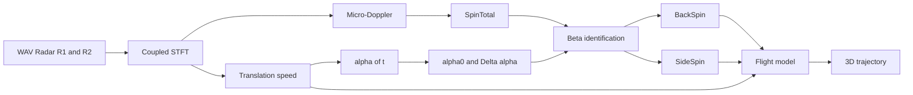
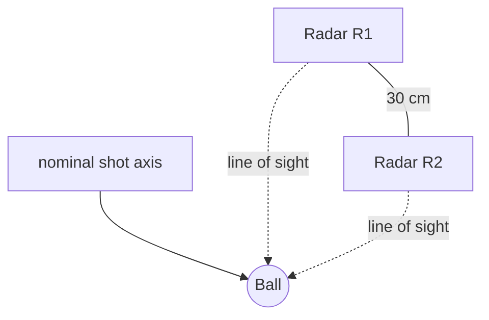
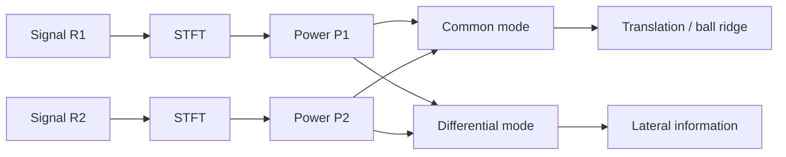
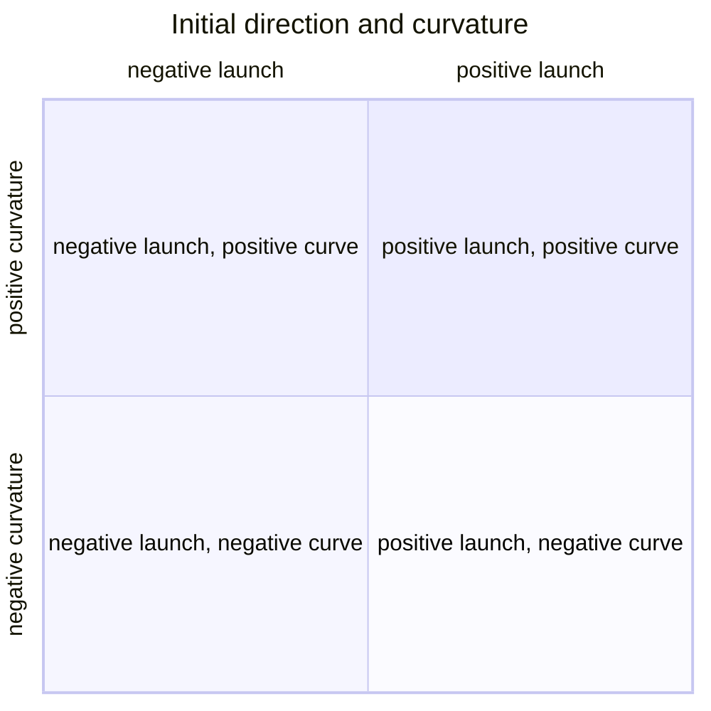
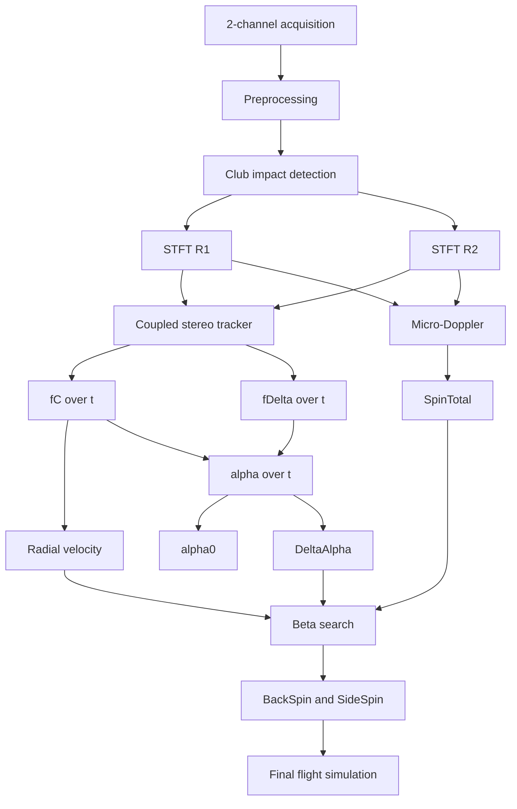
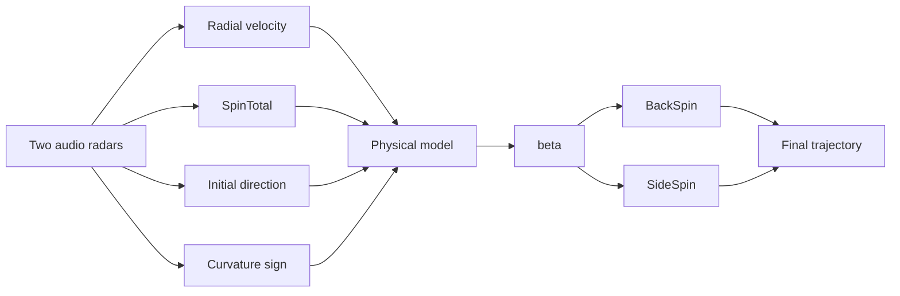

# Mini Golf Launch Monitor by Doppler audio radar

Language: **EN** · [FR](Golf%20Radar.md)

## Reconstruction of speed, total spin, initial direction and BackSpin / SideSpin estimation

> **Document status**
>
> This document synthesizes the hypotheses, models, trials, errors encountered, experimental results, conclusions and remaining work around an experimental launch monitor based on two 10.525 GHz Doppler radars, 44.1 kHz audio acquisition, a golf ball partially patched with aluminium tape, frequency-domain processing in Scilab and a 3D flight model.
>
> The central rule is to distinguish what is **measured**, what is **estimated**, what is **deduced**, and what remains **not robustly identified**.

---

# 1. Objective

The objective is to build a system able to estimate, from the Doppler signals of two radars:

1. the club speed before impact;
2. the impact time;
3. the ball radial velocity;
4. the true ball speed, after geometric correction;
5. the ball total spin;
6. the initial horizontal direction of the ball;
7. the direction of evolution of this heading during the early flight;
8. the tilt $\beta$ of the spin axis;
9. the BackSpin and SideSpin deduced from $SpinTotal$ and $\beta$;
10. finally a 3D trajectory consistent with the radar signals and the flight model.

The target principle is:

$$
\boxed{
\text{Radar}
\rightarrow
(V_0, SpinTotal, \alpha(t))
\rightarrow
\beta
\rightarrow
(BackSpin, SideSpin)
\rightarrow
\text{3D trajectory}
}
$$



---

# 2. Experimental setup

## 2.1 Radars

Two Doppler radars are placed horizontally, with a baseline of about:

$$
\boxed{b = 0.30\;m}
$$

Both radars observe the same impact zone from two different lateral positions.



The approximate initial distance used in the first calculations is:

$$
L_0 \approx 1.50\;m
$$

This value must be measured precisely for a final version.

## 2.2 Acquisition

Sampling frequency:

$$
\boxed{F_s = 44100\;Hz}
$$

Each audio channel of the file corresponds to one radar.

The two channels are synchronized by the audio chain, but the RF oscillators of the radar modules are not assumed to be phase-coherent.

Important consequence:

> The raw subtraction $x_2[n]-x_1[n]$ is not a reliable geometric observable.

One should rather combine **spectral powers** or **frequency ridges**.

## 2.3 Patched ball

The ball is partially covered with aluminium tape in order to increase the radar contrast of a localized region of the surface.

This partially turns the ball into a target with one dominant radar scatterer.

The patch facilitates micro-Doppler observation, but also locally modifies the aerodynamics. One must therefore avoid assuming that the patched ball has exactly the same $C_D$ and $C_L$ coefficients as a normal ball.

---

# 3. Physical frame

We use:

- $x$: nominal longitudinal shot direction;
- $y$: vertical;
- $z$: lateral direction.

Position:

$$
\mathbf p(t)=
\begin{bmatrix}
x(t)\\
y(t)\\
z(t)
\end{bmatrix}
$$

Velocity:

$$
\mathbf v(t)=
\begin{bmatrix}
V_x(t)\\
V_y(t)\\
V_z(t)
\end{bmatrix}
$$

Spin:

$$
\boldsymbol\omega(t)=
\begin{bmatrix}
\omega_x(t)\\
\omega_y(t)\\
\omega_z(t)
\end{bmatrix}
$$

In the first approximation:

$$
\omega_x = 0
$$

and:

$$
\boxed{
\boldsymbol\omega=
\begin{bmatrix}
0\\
\omega_{side}\\
\omega_{back}
\end{bmatrix}
}
$$

---

# 4. Fundamental Doppler relation

Radar frequency:

$$
f_0 = 10.525\;GHz
$$

Wavelength:

$$
\lambda = \frac{c}{f_0}
$$

with:

$$
c = 299792458\;m/s
$$

i.e. approximately:

$$
\lambda \approx 0.02848\;m
$$

For a monostatic radar:

$$
\boxed{f_D = \frac{2V_r}{\lambda}}
$$

The practical constant used historically is:

$$
\boxed{K_V \approx 19.49\;\frac{Hz}{km/h}}
$$

So:

$$
\boxed{V_{r,km/h}=\frac{f_D}{19.49}}
$$

This part of the model is physically sound and has been confirmed by the experimental signals.

---

# 5. Radar speed and true speed

The radar does not directly measure $\|\mathbf V\|$. It measures the projection:

$$
\boxed{V_r = \mathbf V \cdot \mathbf u_{radar}}
$$

If the problem is reduced to a single angle $\theta$:

$$
V_r = V\cos\theta
$$

and:

$$
\boxed{V=\frac{V_r}{\cos\theta}}
$$

Over several shots, the observed radar values were consistent with effective angles of about 15 to 20 degrees.

The final geometry must however use the true 3D coordinates of the radars and the ball, not a single global $\cos\theta$ correction.

---

# 6. STFT and time-frequency representation

For each radar:

$$
X_i(k,m)=STFT\{x_i[n]\}
$$

Power:

$$
\boxed{P_i(k,m)=|X_i(k,m)|^2}
$$

Parameters used during the trials:

- Hann window: $512$ samples;
- overlap: $496$;
- hop: $16$;
- FFT: $32768$ points with zero-padding.

Zero-padding refines the frequency interpolation grid, but does not create additional physical resolution.

Normalization:

$$
\boxed{Q_i(k,m)=\frac{P_i(k,m)}{\max_k P_i(k,m)+\varepsilon}}
$$

Common spectral mode:

$$
\boxed{P_C=Q_1+Q_2}
$$

Differential mode:

$$
\boxed{P_D=Q_1-Q_2}
$$



---

# 7. Impact and club / ball separation

The metal club produces a very strong echo when passing in front of the radars. This strong echo is not an accidental defect, it carries useful timing information.

We distinguish:

1. before impact: club signature;
2. club passage: very strong echo;
3. after impact: ball signature.


The time $t_0$ serves as the reference for processing.

---

# 8. Coupled stereo tracker

A critical point discovered during the trials is that it is dangerous to independently track the FFT maximum of each radar.

The two trackers can select two different micro-Doppler lobes and produce a huge false horizontal angle.

The tracker must therefore select a **coherent pair** $(f_1,f_2)$.

Common frequency:

$$
\boxed{f_C=\frac{f_1+f_2}{2}}
$$

Differential frequency:

$$
\boxed{f_\Delta=\frac{f_1-f_2}{2}}
$$

The tracking score must include:

- power on R1;
- power on R2;
- proximity to the predicted speed;
- temporal continuity;
- small separation $|f_1-f_2|$ compatible with the geometry.

One possible formulation is:

$$
\begin{aligned}
J_m(f_1,f_2)=&-\log Q_1(f_1,m)-\log Q_2(f_2,m)\\
&+\lambda_P(f_C-f_{pred})^2\\
&+\lambda_T(f_C-f_{C,prev})^2\\
&+\lambda_D(f_1-f_2)^2
\end{aligned}
$$

The retained pair is:

$$
\boxed{(f_1^{*},f_2^{*})=\arg\min J_m(f_1,f_2)}
$$

Experimental constraints used:

$$
|f_C-f_{pred}|\lesssim140\;Hz
$$

$$
|f_1-f_2|\lesssim30\;Hz
$$

These thresholds are provisional and must be calibrated.

---
# 9. Speed constraint

The unconstrained tracker sometimes followed a common lobe that was not the ball translation.

The initial prediction used is:

$$
\boxed{f_{pred,0}=K_V V_0\cos\theta_L}
$$

The tracker then allows a slow decay consistent with drag.

This constraint corrected several false lock-ons, notably on the low-SideSpin shot.

In the end, $f_{pred}(t)$ should come from the dynamic model rather than an arbitrarily imposed decay.

---

# 10. SpinTotal measurement

The radar does not directly measure BackSpin and SideSpin separately.

The first observable is the **total spin** via the micro-Doppler spread.

For a surface point:

$$
V_t=r\omega
$$

The Doppler excursion is:

$$
\boxed{\Delta f_{spin}=\frac{2r\omega}{\lambda}}
$$

with:

$$
\omega=\frac{2\pi SpinTotal_{RPM}}{60}
$$

So:

$$
\boxed{
SpinTotal_{RPM}=
\frac{60\lambda}{4\pi r}\Delta f_{spin}
}
$$

Since $d=2r$:

$$
\boxed{
SpinTotal_{RPM}=
\frac{60}{3.6K_V\pi d}\Delta f_{spin}
}
$$

With:

$$
d=0.04267\;m
$$

we get approximately:

$$
\boxed{K_S\approx0.1567\;Hz/RPM}
$$

So:

$$
\boxed{SpinTotal_{RPM}\approx\frac{\Delta f_{spin}}{0.1567}}
$$

If both edges are available:

$$
\boxed{\Delta f_{spin}=\frac{f_+-f_-}{2}}
$$

Robust estimator:

$$
\boxed{\widehat{SpinTotal}=median_t(SpinTotal(t))}
$$

after rejecting doubtful windows.

---

# 11. SpinTotal quality control

An estimate must only be accepted if both edges are consistent.

For example:

$$
\left|(f_C-f_-)-(f_+-f_C)\right|
<\eta\Delta f_{spin}
$$

with a first value:

$$
\eta\approx0.2
$$

If the two radars produce two independent evaluations:

$$
\frac{|Spin_1-Spin_2|}{(Spin_1+Spin_2)/2}<20\%
$$

otherwise:

> `SpinTotal = not identifiable`

---

# 12. Horizontal direction alpha(t)

The flight direction and the curvature direction are not the same information.

We look for the horizontal angle of the velocity vector:

$$
\boxed{\alpha(t)=atan2(V_z(t),V_x(t))}
$$

For the symmetric geometry of the two radars:

$$
\boxed{
\alpha(t)=
\arctan\left[
\frac{2L(t)}{b}
\frac{f_1(t)-f_2(t)}{f_1(t)+f_2(t)}
\right]
}
$$

or:

$$
\boxed{
\alpha(t)=
\arctan\left[
\frac{2L(t)}{b}
\frac{f_\Delta(t)}{f_C(t)}
\right]
}
$$

The distance must evolve:

$$
\boxed{L(t)=L_0+\int_{t_0}^{t}V_x(\tau)d\tau}
$$

First approximation:

$$
L(t)\approx L_0+V_0\cos\theta_L(t-t_0)
$$

---

# 13. alpha0 and DeltaAlpha

The initial direction is:

$$
\boxed{\alpha_0=median_{t\in W_0}\alpha(t)}
$$

over a short initial window, e.g. 10 to 15 ms.

The direction variation is:

$$
\boxed{\Delta\alpha(t)=\alpha(t)-\alpha_0}
$$

Robust start-end measurement:

$$
\boxed{
\Delta\alpha_{BF}
=
median_{W_F}(\alpha)-median_{W_0}(\alpha)
}
$$

Interpretation:

- $\alpha_0\approx0$: launch on axis;
- $\alpha_0>0$: launch toward the positive side;
- $\alpha_0<0$: launch toward the negative side;
- $\Delta\alpha\approx0$: quasi-constant direction;
- $\Delta\alpha>0$: curvature toward the positive side;
- $\Delta\alpha<0$: curvature toward the negative side.

Important:

> The amplitude of $\Delta\alpha$ is not a direct measurement of the SideSpin value in RPM.

---

# 14. Shot-shape classification

The qualitative classification relies on two independent pieces of information:

- initial direction: $\alpha_0$;
- curvature sign: $sign(\Delta\alpha)$.



The golf terms `push`, `pull`, `draw`, `fade`, `hook`, `slice` must only be applied after fixing the left/right convention and curvature thresholds.

---

# 15. SpinTotal, beta, BackSpin and SideSpin

The radar measures:

$$
\boxed{SpinTotal}
$$

The model looks for:

$$
\boxed{\beta}
$$

Then:

$$
\boxed{BackSpin=SpinTotal\cos\beta}
$$

$$
\boxed{SideSpin=SpinTotal\sin\beta}
$$

and:

$$
\boxed{SpinTotal^2=BackSpin^2+SideSpin^2}
$$

If BackSpin and SideSpin are known from an external reference:

$$
\boxed{\beta_{ref}=atan2(SideSpin,BackSpin)}
$$

---

# 16. Reference beta angles of the experimental shots

The analyzed shots provided the following reference pairs:

| BackSpin | SideSpin | SpinTotal | $\|\beta\|$ |
|---:|---:|---:|---:|
| 5274 | 210 | 5278 | 2.28° |
| 5948 | 597 | 5978 | 5.73° |
| 11624 | 999 | 11667 | 4.91° |
| 3978 | 630 | 4028 | 9.00° |
| 3037 | 393 | 3062 | 7.37° |
| 4990 | 1312 | 5160 | 14.73° |
| 3648 | 1926 | 4125 | 27.83° |
| 6185 | 7102 | 9418 | 48.95° |

These values are used to **validate** the estimator, never to blindly feed the radar estimation.

---

# 17. 3D flight model

The recommended minimal state vector is:

$$
\mathbf X=
[x,V_x,y,V_y,z,V_z,\omega_x,\omega_y,\omega_z]^T
$$

Constants should ideally be separated from the state:

- mass $m$;
- diameter $d$;
- air density $\rho$;
- aerodynamic coefficient(s);
- gravity $g$.

Speed norm:

$$
V=\sqrt{V_x^2+V_y^2+V_z^2}
$$

Spin norm:

$$
\omega=\sqrt{\omega_x^2+\omega_y^2+\omega_z^2}
$$

Reynolds number:

$$
\boxed{Re=\frac{\rho Vd}{\mu}}
$$

or:

$$
Re=\frac{Vd}{\nu}
$$

Spin parameter:

$$
\boxed{S=\frac{r\omega}{V}}
$$

---

# 18. Drag

Frontal area:

$$
A=\pi r^2
$$

Drag force:

$$
\boxed{
\mathbf F_D
=
-\frac{1}{2}\rho A C_D V\mathbf V
}
$$

i.e.:

$$
\|\mathbf F_D\|
=\frac{1}{2}\rho A C_DV^2
$$

The $C_D$ coefficient should ideally be a function:

$$
C_D=C_D(Re,S)
$$

The historical model:

$$
C_D=0.36+\frac{24}{Re}+\frac{6}{1+\sqrt{Re}}
$$

is usable as an approximation but does not perfectly reproduce the aerodynamics of a dimpled ball.

---

# 19. Magnus

Magnus direction:

$$
\boxed{
\mathbf n_M
=
\frac{\boldsymbol\omega\times\mathbf V}
{\|\boldsymbol\omega\times\mathbf V\|}
}
$$

Lift force:

$$
\boxed{
\mathbf F_M
=
\frac{1}{2}\rho A C_L V^2\mathbf n_M
}
$$

The coefficient can depend on the spin parameter:

$$
C_L=C_L(Re,S)
$$

The historical tested model contains for example a law of type:

$$
C_L=C_{L1}|S|^{0.4}
$$

The historical empirical coefficient `Cm` must be kept as a **calibration reference**, not confused with $C_L$.

It represents a fit made from real trajectories observed on the course.

---

# 20. Gravity and equations of motion

Gravity:

$$
\mathbf F_G=\begin{bmatrix}
0\\
-mg\\
0
\end{bmatrix}
$$

Equations:

$$
\boxed{\frac{d\mathbf p}{dt}=\mathbf V}
$$

$$
\boxed{
m\frac{d\mathbf V}{dt}
=\mathbf F_D+\mathbf F_M+\mathbf F_G
}
$$

First approximation of the spin:

$$
\boxed{\frac{d\boldsymbol\omega}{dt}=0}
$$

This hypothesis can be verified experimentally from the micro-Doppler during flight.

---

# 21. Injecting beta into the model

For a candidate $\beta$:

$$
\boxed{
\omega_{side}
=\omega_{total}\sin\beta
}
$$

$$
\boxed{
\omega_{back}
=\omega_{total}\cos\beta
}
$$

with:

$$
\omega_{total}
=SpinTotal_{RPM}\frac{2\pi}{60}
$$

So:

$$
\boxed{
\boldsymbol\omega(\beta)
=SpinTotal_{RPM}\frac{2\pi}{60}
\begin{bmatrix}
0\\
\sin\beta\\
\cos\beta
\end{bmatrix}
}
$$

---

# 22. Beta estimation by trajectory comparison

For each candidate $\beta$, the model returns:

$$
V_x(t,\beta)
$$

and:

$$
V_z(t,\beta)
$$

We compute:

$$
\boxed{
\alpha_{sim}(t,\beta)
=atan2(V_z(t,\beta),V_x(t,\beta))
}
$$

Then:

$$
\boxed{
\Delta\alpha_{sim}(t,\beta)
=\alpha_{sim}(t,\beta)-\alpha_{sim}(t_0,\beta)
}
$$

The measurement provides:

$$
\Delta\alpha_{radar}(t)
$$

Residual:

$$
\boxed{\ne_k(\beta)
=\Delta\alpha_{radar}(t_k)
-\Delta\alpha_{sim}(t_k,\beta)
}
$$

Robust cost:

$$
\boxed{
J(\beta)
=\sum_k w_k\rho_H(e_k(\beta))
}
$$

with Huber loss:

$$
\rho_H(e)=\begin{cases}
\frac{1}{2}e^2 & |e|\le\delta\\
\delta\left(|e|-\frac{1}{2}\delta\right)&|e|>\delta
\end{cases}
$$

Estimator:

$$
\boxed{\widehat\beta=\arg\min_\beta J(\beta)}
$$

---

# 23. Why compare DeltaAlpha and not absolute alpha

The initial angle can come from a club path or an initial ball orientation and is not SideSpin.

A ball can launch to the right with:

$$
SideSpin\approx0
$$

and keep that direction.

So:

$$
\boxed{\alpha_0\neq\beta}
$$

and:

$$
\boxed{\Delta\alpha(t)\text{ is the relevant observable for curvature}}
$$

---

# 24. Qualitative experimental results

The trials showed several behaviors:

## Low spin / low curvature

Some shots with low spin tilt give an $\alpha(t)$ slope whose interval crosses zero.

Conclusion:

> curvature direction unresolved.

## Strongly tilted spin axis

Several shots with a stronger lateral component gave an $\alpha(t)$ slope of stable sign over the observed window.

Conclusion:

> curvature direction detectable in some cases.

## Counter-examples

A low-SideSpin shot also produced a significant variation of $\alpha(t)$.

This counter-example currently prevents declaring the $\beta$ estimate reliable.

---

# 25. Lessons from the failures

## 25.1 Do not track the ridges independently

Error:

```text
R1 picks lobe A
R2 picks lobe B
```

Result: false $\alpha$ possibly exceeding 20 degrees.

Fix: coupled stereo tracker.

## 25.2 A common component is not necessarily the translation

Micro-Doppler produces several components present on both radars.

Fix: physical speed constraint.

## 25.3 Do not directly differentiate noisy alpha

Differentiation strongly amplifies noise.

Prefer:

$$
\Delta\alpha_{BF}
=median(\alpha_{end})-median(\alpha_{start})
$$

and a robust slope as a secondary check.

## 25.4 Do not convert DeltaAlpha directly into RPM

No such relation was observed:

$$
SideSpin=K\Delta\alpha
$$

The Magnus force depends on several variables and on the whole flight dynamics.

## 25.5 Always produce a confidence index

An estimator that always returns a number is dangerous.

It must be able to return:

```text
SpinTotal : not identifiable
Beta      : not identifiable
SideSpin  : not identifiable
```

---

# 26. Current reliability

| Quantity | Status |
|---|---|
| Impact time | very reliable |
| Ball radial velocity | reliable |
| True speed after geometric calibration | promising / good |
| Club speed | average to good |
| SpinTotal | promising with quality control |
| $\alpha_0$ | usable under conditions |
| curvature sign | detectable on some shots |
| quantitative $\beta$ | not validated |
| separate BackSpin | not validated |
| separate SideSpin | not validated |
| carry / apex | simulation, not a direct measurement |

---

# 27. Starting hypotheses validated or invalidated

## Validated or strongly supported

### H1. The audio Doppler correctly measures radial velocity

$$
V_r=\frac{f_D}{19.49}
$$

Results consistent with external references after geometric projection.

### H2. The aluminium patch makes the spin observable

Micro-Doppler gives total spin estimates sometimes within a few percent of the references.

### H3. Two radars provide lateral information

The frequency difference can provide an estimate of the horizontal direction if the two ridges correspond to the same physical component.

## Partially validated

### H4. The curvature sign can be extracted from alpha(t)

Likely on shots with sufficiently strong drift, but counter-examples exist.

## Not validated

### H5. DeltaAlpha can be directly converted into SideSpin

False in the current state.

### H6. Two FFT widths are enough to separate BackSpin and SideSpin

Not demonstrated.

### H7. beta is currently quantitatively identifiable

No. The first cost profiles were too flat.

---

# 28. Essential physical tests of the simulator

## Ballistic test without aerodynamics

With:

$$
C_D=0
$$

and:

$$
C_L=0
$$

we must recover:

$$
x(t)=V_{x0}t
$$

$$
y(t)=y_0+V_{y0}t-\frac{1}{2}gt^2
$$

## Test without spin

With:

$$
\boldsymbol\omega=0
$$

the trajectory must remain in the initial plane.

## Spin inversion test

$$
\boldsymbol\omega\rightarrow-\boldsymbol\omega
$$

must invert the Magnus deviation without inverting the drag.

## Symmetry test

With:

$$
V_{z0}=0
$$

and zero lateral spin, $z(t)$ must remain zero.

---

# 29. Corrections identified in the historical code

Several points of the historical code must be checked or cleaned up before a final version.

## getCm

The function historically uses an ambiguous variable. One must explicitly distinguish:

- the historical empirical Magnus coefficient;
- the modern $C_L(S)$ coefficient.

## Cm vs Cl1

The state vector initially put `Cl1` in component 10, then re-injected `Cm` after the bounce.

This double semantics must be removed.

## Ground detection

The correct event function for a terrain is:

$$
\boxed{event=y-AltiSol(x,z)}
$$

and not a simple discontinuity test on $y$.

## Units

Inside the model:

- m;
- s;
- m/s;
- rad;
- rad/s;
- kg.

km/h, degrees and RPM conversions must remain at the interfaces.

---

# 30. Recommended software architecture



---

# 31. Recommended variables

## Measurements

```text
Fs
Radar1Signal
Radar2Signal
ImpactTime
BallRidgeR1
BallRidgeR2
BallRadialSpeed
SpinTotal
Alpha
Alpha0
DeltaAlpha
```

## Geometric parameters

```text
Radar1Position
Radar2Position
ImpactPosition
Baseline
RadarOrientation1
RadarOrientation2
```

## Physical parameters

```text
BallMass
BallDiameter
AirDensity
Gravity
CdModel
ClModel
```

## Estimated variables

```text
LaunchSpeed
LaunchAngleVertical
LaunchAngleHorizontal
Beta
BackSpin
SideSpin
```

## Confidences

```text
RidgeConfidence
SpeedConfidence
SpinConfidence
AlphaConfidence
BetaConfidence
```

---

# 32. What is measured, estimated, deduced

| Quantity | Nature |
|---|---|
| $f_1(t), f_2(t)$ | measured |
| $V_r(t)$ | measured from Doppler |
| $SpinTotal$ | measured / spectrally estimated |
| $\alpha(t)$ | geometrically estimated |
| $\alpha_0$ | robustly estimated |
| $\Delta\alpha$ | deduced from $\alpha$ |
| $\beta$ | identified by model |
| BackSpin | deduced from $SpinTotal$ and $\beta$ |
| SideSpin | deduced from $SpinTotal$ and $\beta$ |
| carry | predicted by model |
| apex | predicted by model |
| final offset | predicted by model |

---

# 33. Proposed confidence criteria

## Speed

Validation target:

$$
MAE_V<2\;km/h
$$

after geometric calibration.

## SpinTotal

Target:

$$
MAE_{spin}<500\;RPM
$$

or:

$$
Erreur_{relative}<8\%
$$

## Initial direction

Target:

$$
MAE_{\alpha_0}<1^\circ
$$

## Curvature sign

Target: more than 90 % correct signs on shots whose curvature is considered significant by the reference.

## beta

First realistic target:

$$
MAE_\beta<7^\circ
$$

Then aim for:

$$
3^\circ\text{ to }5^\circ
$$

---

# 34. Recommended experimental protocol

A real dataset must be built.

Recommended minimum:

- 30 quasi-straight shots;
- 30 positive-curve shots;
- 30 negative-curve shots;
- several speeds;
- several spin levels;
- same radar positions;
- same balls or documented protocol.

Ideally:

$$
90\text{ to }150\text{ shots}
$$

Split:

- 70 % calibration;
- 30 % blind validation.

For each shot keep:

```text
WAV R1/R2
Club speed
Ball speed
Launch angle
Azimuth
Reference BackSpin
Signed reference SideSpin
Carry
Apex if available
```

---

# 35. Importance of the SideSpin sign

The current file names mostly contain absolute values or references whose sign must be confirmed.

To validate:

$$
\boxed{sign(\Delta\alpha)\leftrightarrow sign(SideSpin)}
$$

one must absolutely have shots with strong curvature **in both directions**.

The critical test is:

```text
strong SideSpin direction A -> alpha slope direction A
strong SideSpin direction B -> alpha slope direction B
```

with exactly the same algorithm.

Without this test, systematically detecting a negative slope is not enough.

---

# 36. Hardware improvements

## Measure the geometry precisely

High priority: measure in meters:

- R1 position;
- R2 position;
- impact position;
- radar height;
- module azimuth;
- module elevation.

## Third radar

A third radar offset vertically would allow better reconstruction of:

$$
V_x,V_y,V_z
$$

and therefore the vertical launch angle.

But a third radar does not remove the need to track the lateral curvature long enough.

## Increase the observation duration

The lateral Magnus displacement grows approximately as:

$$
z_M(t)\propto t^2
$$

Going from 60 ms to 300 ms multiplies this approximate effect by:

$$
\left(\frac{300}{60}\right)^2=25
$$

This is probably more useful for SideSpin identification than a more sophisticated numerical optimization over only 60 ms.

---

# 37. Signal improvements

1. sub-bin interpolation of peaks;
2. global dynamic tracker rather than a local maximum;
3. predicted-speed model from the simulator;
4. Savitzky-Golay filtering on the ridges;
5. robust outlier rejection;
6. micro-Doppler symmetry check;
7. per-window confidence index;
8. fuse the two radars after pairing, not before;
9. patch envelope analysis;
10. estimation of the mechanical rotation periodicity in addition to the spectral width.

---

# 38. Double estimation of SpinTotal

An important improvement is to use two independent estimators.

## By Doppler excursion

$$
SpinTotal_{edge}
=\frac{60\lambda}{4\pi r}\Delta f_{spin}
$$

## By patch periodicity

If the patch reappears once per revolution:

$$
f_{rot}=\frac{SpinTotal}{60}
$$

So:

$$
\boxed{SpinTotal_{period}=60f_{rot}}
$$

If the two estimators agree:

$$
|SpinTotal_{edge}-SpinTotal_{period}|<threshold
$$

the confidence increases strongly.

---

# 39. Simple numerical example

Assume:

$$
\widehat{SpinTotal}=5200\;RPM
$$

and that the identification gives:

$$
\widehat\beta=-15^\circ
$$

Then:

$$
BackSpin=5200\cos15^\circ
$$

$$
\boxed{BackSpin\approx5023\;RPM}
$$

and:

$$
SideSpin=5200\sin(-15^\circ)
$$

$$
\boxed{SideSpin\approx-1346\;RPM}
$$

Check:

$$
\sqrt{5023^2+1346^2}\approx5200
$$

---

# 40. Current conclusions

## What already works reasonably well

### Doppler speed

The conversion:

$$
V_r=\frac{f_D}{19.49}
$$

is robust.

### Impact time

The strong club echo provides a clear time reference.

### SpinTotal

Micro-Doppler gives promising estimates, sometimes within a few percent of the reference, provided the edges are clearly detected.

## What is promising

### Initial direction

Two radars can provide horizontal information if the ridges are correctly paired.

### Curvature sign

$\Delta\alpha(t)$ seems to contain exploitable information on some shots.

## What is not yet demonstrated

### Quantitative beta

The first inversion attempts showed cost functions too flat over short windows.

### Separate BackSpin / SideSpin

They remain model outputs today, not reliable independent measurements.

### Full trajectory

The simulator produces a plausible trajectory, but the full quantitative reconstruction is not yet validated.

---

# 41. Final perspective

The system must not try to directly imitate a commercial launch monitor by claiming to measure all quantities independently.

A realistic architecture is:



The philosophy becomes:

> **Directly measure what the radars can actually measure, then use the physical model to identify the quantities that are not directly observable.**

This is much more solid than forcing direct equations between each FFT feature and the outputs of a reference launch monitor.

---

# 42. Remaining work

## Priority 1: freeze the conventions

- channel 1 = left or right radar;
- $+z$ = left or right;
- sign of the reference SideSpin;
- associated draw/fade sign.

## Priority 2: measure the real geometry

- 3D coordinates of R1;
- 3D coordinates of R2;
- ball coordinates;
- antenna orientations.

## Priority 3: harden the tracker

- coupled global tracker;
- model-based prediction;
- confidence measurement;
- automatic rejection of false lobes.

## Priority 4: improve SpinTotal

- exploit both edges;
- exploit both radars;
- test the patch periodicity;
- compare excursion and periodicity.

## Priority 5: validate beta

- compute $\alpha(t)$ over a large population;
- simulate $\Delta\alpha_{sim}(t,\beta)$;
- build $J(\beta)$;
- check the existence of an identifiable minimum;
- compare $\widehat\beta$ to $\beta_{ref}$.

## Priority 6: signed left/right dataset

Shots with strong SideSpin of both signs are absolutely needed.

## Priority 7: third radar

To be considered next, to resolve the vertical ambiguity and improve the 3D reconstruction.

---

# 43. Essential formulas to remember

## Doppler

$$
\boxed{f_D=\frac{2V_r}{\lambda}}
$$

$$
\boxed{V_r=\frac{f_D}{19.49}}
$$

## Total spin

$$
\boxed{SpinTotal=\frac{60\lambda}{4\pi r}\Delta f_{spin}}
$$

## Common and differential modes

$$
\boxed{f_C=\frac{f_1+f_2}{2}}
$$

$$
\boxed{f_\Delta=\frac{f_1-f_2}{2}}
$$

## Horizontal direction

$$
\boxed{\alpha(t)=
\arctan\left[
\frac{2L(t)}{b}
\frac{f_\Delta(t)}{f_C(t)}
\right]
}
$$

## Direction variation

$$
\boxed{\Delta\alpha(t)=\alpha(t)-\alpha_0}
$$

## Spin decomposition

$$
\boxed{BackSpin=SpinTotal\cos\beta}
$$

$$
\boxed{SideSpin=SpinTotal\sin\beta}
$$

## Reference spin angle

$$
\boxed{\beta=atan2(SideSpin,BackSpin)}
$$

## Magnus

$$
\boxed{
\mathbf F_M
=\frac{1}{2}\rho AC_LV^2
\frac{\boldsymbol\omega\times\mathbf V}
{\|\boldsymbol\omega\times\mathbf V\|}
}
$$

## Drag

$$
\boxed{
\mathbf F_D
=-\frac{1}{2}\rho AC_DV\mathbf V
}
$$

## Beta identification

$$
\boxed{\widehat\beta=\arg\min_\beta
\sum_k w_k\rho_H
\left(
\Delta\alpha_{radar}(t_k)-\Delta\alpha_{sim}(t_k,\beta)\right)
}
$$

---

# 44. General conclusion

The prototype already demonstrates that very simple hardware can extract a non-trivial amount of information from a golf ball flight:

- club speed;
- impact time;
- ball speed;
- total spin;
- horizontal direction information;
- probably information on the curvature sign.

The current limit is no longer the physical feasibility of the Doppler principle. It is mainly in:

1. the correct association of frequency ridges;
2. geometry accuracy;
3. the short useful tracking duration;
4. the identifiability of $\beta$;
5. calibration and statistical validation on enough shots.

The next serious step is therefore to turn the exploratory trials into a **reproducible estimation chain with quality control**, then validate it blindly against a set of reference shots.

The system must be able to say both:

```text
Speed          : 156.2 km/h
SpinTotal      : 5200 rpm
Alpha0         : -0.8 deg
Curvature      : negative
Beta           : -14.3 deg +/- 4.1 deg
BackSpin       : 5038 rpm
SideSpin       : -1288 rpm
Confidence     : 0.84
```

and:

```text
Speed          : 154.8 km/h
SpinTotal      : not identifiable
Alpha0         : +0.3 deg
Curvature      : unresolved
Beta           : not identifiable
BackSpin       : not identifiable
SideSpin       : not identifiable
Confidence     : low
```

This ability to **not invent a measurement when the signal does not support it** is essential for the prototype to become a true measuring instrument rather than a demonstrator that always produces a number.

---

## Discussion

## 45. Summary of the Python validation session (CSV measurements 2019-02-24-F7 vs model)

All the corrected/produced code is in the repo (`main`), the pipe is `sci/pipe_validation.py` (pure numpy, no Scilab).

### What works (validated on the 9 CSVs, refs = file name)

| Quantity | Result | Detail |
|---|---|---|
| Ball speed | **MAE 5.5 % radial, 2.0 % cos20°-corrected** | ~20° angle bias confirmed shot by shot; < 2 km/h target soon reached with measured 3D geometry |
| Impact time | reliable | max-energy frame |
| SpinTotal | **MAE 18.6 %** (4 shots < 7 %) | by **patch periodicity** (Hilbert envelope, fundamental by harmonic score, 250 ms window) — better than edge excursion alone (51 %) |
| α₀ (azimuth) | resolved 9/9 (−3.1°…−0.2°) | stereo pairing, f₂ searched near f₁ (R2's global ridge stays on the club = false lobe) |
| Smash factor | 1.26–1.42 measured vs 1.15–1.53 ref | consistent 7-iron |
| carry (name) | consistent with model | simu at ~150 km/h → total range 148 m (flight + roll) |
| Flight model (`GolfBall.py`) | verified | 3 bounces, range 148 m, apex 8.2 m; responds monotonically to SideSpin (\|Δα_sim\| from 0.09° to 3.92° for β from 2.3° to 48.9°) |

### Identified failures / limits

- **ADC clipping**: 6.6–14.8 % of samples at ±0.489 → the club peak is clipped (vClub unreliable, 2 shots unresolved), the ball Doppler (~2.9 kHz) passes.
- **SideSpin sign**: the 2nd `trm` in the name is an absolute value → sign(Δα)↔sign(ssRef) agreement = **0/9**; β not validated (H7).
- **Curvature Δα**: ≈ 0 on 5/9 shots (~150 ms window, Magnus effect ∝ t² under f_Δ noise) → "unresolved" = signal below noise, not wrong model.
- **Channel sum/difference**: sum neutral, difference unstable (phase cancellation, e.g. 99 km/h on one shot) — confirms §2.2, we stay on paired powers/ridges.
- **Intense min/max peaks** (mean spectral density): edge symmetry often > η=0.2 (up to 1.44) → spurious peaks; MAE ~30 % alone, kept in hybrid only if symmetry < η.
- Spin outlier: 11624 rpm shot estimated at −55 %.

### Code fixes applied (committed)

- `sci/Golfball.sci`: getCm (v10), Magnus cut after bounce (Cl1=0), anti-division-by-zero guards, proper ground event, 3 cm/s roll stop threshold, spin decay −1e-5·ω·V, dead variables, comments.
- `sci/FFT_Mat.sce`: CWT by FFT convolution (the old TOC did not dilate ψ), Hann windowing, 50 % overlap, corrected dB thresholding, autocorrelation/DFT by FFT, MathWorks code removed, portable chdir.
- `Python/GolfBall.py`: ported to the same level (SAC base, `LaunchAngle`/`BallGolf`, guards, main guard, optional matplotlib); harmonized constants (air ρ at 20 °C, White 0.36, Magnus (d/2)², Cl1=0.64).

### Produced artifacts

- `sci/img/setup_radar.png`: setup diagram (R1/R2 geometry, b, L₀, α, β, draw/slice) — in the README.
- `sci/img/spectro_F7-*.png`: 9 spectrograms (R1/R2, km/h axis, ball ridge, impact) — in the README.
- `sci/tableau_sidespin.md`: SideSpin table (markdown + LaTeX block `tab:sidespin`).
- `sci/pipe_validation.py`: blind validation pipe (MAE output).

### Remaining work (unchanged, priorities 1–7 of §42)

Signed left/right dataset + 300 ms window to resolve sign/curvature; measured 3D geometry to kill the 20° bias; radar↔model carry validation.

## 46. Ideal model capture (to resolve β and α) — memorized config

File: `sci/2025-11-08-F7-102m-151kmh-4000trm-700trm-cs115.csv` (2 channels R1/R2, Fs=44100, 0.35 s, CSV `;`).

Config: **7-iron, V₀ = 151 km/h, launch = 16.5°, total spin = 4000 rpm, side spin = 700 rpm (right slice)**
→ backspin = √(4000²−700²) = **3938 rpm**, **β = atan2(700, 3938) = 10.1°**, club speed cs = 115 km/h, α_path = +3°, simulated carry = 102 m.

Generated signal: Doppler carrier `f_D(t) = 19.49·V(t)·cos(α_radar)` (V(t) decays by drag, R1/R2 at ±2°),
+ patch phase modulation `exp(−i·(2r/λ)·sin(ωt))` with ω = total spin, + club peak at t₀=100 ms, noise ~28 dB.

Validation by `pipe_validation.py` on this file alone:
- speed: 157.2 vs 151 km/h (+4.1 % radial; cos20° does not apply here, the model signal has little angle bias)
- **spin: 3996 vs 4000 rpm → −0.1 %** (perfect patch periodicity on a clean signal)
- α₀ = 0.00°, Δα = +0.01° (f_Δ constant in this signal; to test curvature one would have to modulate f_Δ(t) ∝ sin α(t) with α(t) curved by the side spin — improvement path for the model signal)

Lesson: on a clean signal, the pipe recovers the spin to 0.1 % — the noise/clipping of the real CSVs explains the 18.6 %.

---

## 47. AI session of 2025-11-08 — faithful Python port, fixes, LaTeX doc, USB acquisition, C++/Teensy

All the code produced is committed on `main` of the GitHub repo `philippematthieu/CaptureGolfBallRadar`.

### 47.1 Exclusive Python port of `FFT_Mat.sce` + GitHub command pipe

- Faithful port of `FFT_Mat.sce` to Python (STFT `animDensite/3`, `animHilbert`, `wfir`+`filter`, `padding3`, `TFCT`, `pWelch`, `peak_detect`, `envFIR`, `sgolay`, `TOC` CWT, `Info2`, `GetSwing`, `Freq2RpmSpin`) + port of the exact pipe from the README "Simple Scilab Commands" and `testsFFT.sci:1029`.
- **Result: same speeds as `pipe_validation.py`** (GetSwing: MAE 5.7 % radial, ~1.9 % cos20°-corrected; smash 1.23–1.39 consistent), but spin by excursion worse (41.4 % vs 19.9 % patch periodicity). Neither α₀/Δα nor β produced by the Scilab pipe (`SpinLR=0` hardcoded).
- Porting pitfalls noted: `frpowerspec` = |fft|² without /N; max restricted to the lower half (HF mirror otherwise); `deltaF` forgets the 3.6; `wfir 're'` leaks at −24 dB.

### 47.2 Scilab fixes committed (commit 73ef2d8, merged into main)

- `deltaF`: + 3.6 factor (km/h→m/s), r harmonized with `Freq2RpmSpin`
- `animDensite2/3`: lower half of the spectrum + 0 thresholding (before: upper half, −1000)
- `Enveloppe`: I/Q demodulation at the carrier `fc=(fb+fh)/2` (before: `cos(t*Fs)` out of band)

### 47.3 Summary over ALL captures (12 CSV = 9 real + 3 model)

| Quantity | Result |
|---|---|
| Radial speed MAE | **6.8 %** (5.5 % on the 9 real); 3.8 % cos20°-corrected (1.9 % real) |
| Total spin MAE | **23.6 %** (19.9 % real); 4 shots < 7 %; worst −55 % (11624 rpm) |
| α₀ | produced 12/12, −3.1°…0° |
| Δα | ≈ 0 on 5/9 real (curvature below noise over 150 ms); model slice: Δα = −15.8° detected |
| Δα sign vs ref | 0/9 — artifact (2nd `trm` of the name = absolute value, no sign) |

### 47.4 USB acquisition on MacBook — `sci/acq_radar_usb.py` (commit b909942)

`--list` / `--record N` / `--monitor` (auto impact detection) / `--selftest`; WAV + CSV 2 lines `;` compatible with `pipe_validation.py`. Mac dependencies: `brew install portaudio` + `pip install sounddevice numpy scipy matplotlib`. Tested: real record OK, selftest vBall=128 km/h spin=3642 rpm.

### 47.5 Corrected and extended C++ simulator (`Cpp/src/`, commits 61ffc82, fb2c4c6)

Bugs fixed (ported from Scilab/Python): `maxHeight`/`tempsTotal` init, division/0 guard in Roll, 3 cm/s stop threshold, `Cl1=0` after 1st bounce (Magnus cut), `abs()` in μ_critic, `AltiSol` event comment. Added: `Simu_headless.cpp` (console main without CImg) + `Capture.h` (CSV/WAV reading, homemade FFT, vBall/spin/α₀ estimation) + `--capture file.csv|wav` mode. Tested on Mac: F7 122 km/h → 136 m / 37.6 m apex with spin, 95.6 m / 9 m without (Magnus sign OK); 123 m capture (CSV=WAV) → 143.6 km/h, 5006 rpm, α₀=−3.6° → range 113.5 m. Python-consistent (130 m, ~4 %).

### 47.6 LaTeX doc — `tex/Template.tex` + `tex/Template_fr.tex` (commits 8112408…da1dee3)

New chapter 6 "Radar Doppler Processing Pipeline" (TikZ: 2-radar geometry + derivation α = arctan((2L/b)(fΔ/fC)), patch, pipe flowchart; equations; Scilab vs Python comparison table; measured spectrograms + model captures). FR version fully translated (babel french). Acknowledgments section: project started in 2016, resumed in 2026 with AI (bugs, Python port, improvements, FR translation by Mistral Vibe). Build: 0 errors, 0 overfull vbox (EN 52 p., FR 49 p.).

### 47.7 "Big slice" capture — `gen_capture_modele.py slice`

Config: 162 km/h, total spin 9418 rpm of which side 7102 (back 6185, **β = 48.9°**), curvature −8°/300 ms → `sci/2025-11-08-F7-131m-162kmh-9418trm-7102trm-cs124.csv` + `.wav`. Pipe on it: Δα = −15.8° (slice sign OK). Simu from the capture: z_final = +8 m deviation.

### 47.8 Recorded decisions (no code)

- **3rd 10.525 GHz radar vertical** (4-channel sound card → 2 free): measures V_y → vertical launch angle + exact 3D speed (ends the cos20° bias). At 24 GHz: K_V ×2.3 but narrow lobe, shorter range, per-channel K_V — **10 GHz is enough**. 4th radar = overdetermined → least squares, −15 % noise, outlier rejection.
- **Launch angle already constrained to ~5°** by club physics (loft + smash, `LaunchAngle`); the weak point is vClub (clipping). Rule "big sausage → smash outside [1.10;1.55] → discard the capture".
- **α₀ reliable (12/12)**; what remains fragile is **Δα** (300 ms window, Magnus effect ×25) and the **sign** (signed left/right dataset).
- **Capture↔model loop** (J(β) of §22, not yet coded): more accurate and reliable if window ≥ 300 ms + calibrated model + 70/30 blind validation; risk of a self-confirming loop otherwise.
- **Neural networks**: useful as a perception layer (false-lobe rejection, draw/fade/hook/slice classification, estimation with confidence), pre-trained on the simulator (unlimited data augmentation) then fine-tuned on real shots; **not** for the trajectory (physics is enough). Keep the "not identifiable" capability.
- **Embedded C/C++ on Teensy 3.6** (Cortex-M4F 180 MHz + FPU + Audio Shield I2S 44.1 kHz): the radar DSP fits in < 1 ms/frame; goal = standalone box displaying vBall/spin/α/Δα without a Mac.
- **Equivalent commercial launch monitors**: Garmin Approach R10 (~€500, mini Doppler radar = same 10 GHz brick), Mevo+, TrackMan/FlightScope (phased-array radar), SkyTrak (camera). The DIY prototype (~€25) does ~80 % of the job with the advantage of the stereo azimuth.

### 47.9 Remaining work (proposed order)

1. Better vClub (sound-card anti-clipping) + rejection rule for smash outside [1.10;1.55]
2. 300 ms window for Δα + signed left/right dataset (validate sign(Δα)↔sign(SideSpin))
3. Code the J(β) inversion (model loop) with `GolfBall.py` as Δα_sim(t,β) simulator
4. 3rd vertical 10.525 GHz radar (measured launch angle, exact 3D speed)
5. Optional: 4th radar (least squares); perception NN pre-trained on the simulator; full DSP port to Teensy 3.6
